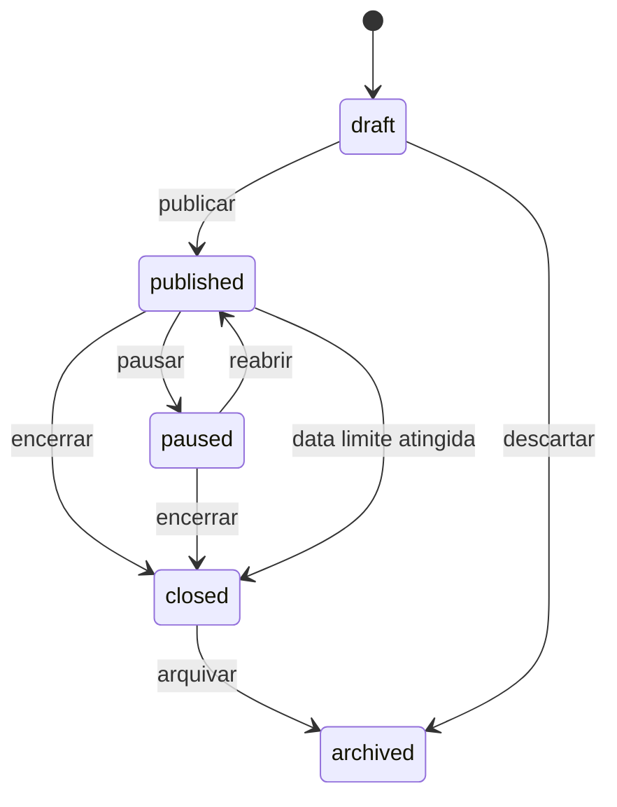

# Regras de negócio

> Cada regra tem um identificador (RN-XXX-NN) para ser citada no código, nos testes e nos PRs.
> Toda regra precisa de pelo menos um teste automatizado que a referencie no nome ou na docstring.
> Valores marcados com ⚙ são configuráveis pelo administrador; os números aqui são o padrão inicial.

## 1. Contas (ACC)

| ID | Regra |
| --- | --- |
| RN-ACC-01 | Um e-mail corresponde a uma única conta. |
| RN-ACC-02 | Toda conta nasce com o ambiente de candidato disponível. Não existe "conta de empresa" separada: a pessoa cria ou entra em organizações. |
| RN-ACC-03 | Cadastro exige aceite das versões vigentes dos termos e da política de privacidade. Quando uma nova versão for publicada, o usuário precisa aceitar no próximo acesso para continuar. |
| RN-ACC-04 | Sem e-mail verificado, o usuário pode montar perfil e cofre, mas não pode se candidatar, criar organização nem publicar vaga. |
| RN-ACC-05 | Conta suspensa não faz login; candidaturas ficam visíveis às empresas como "candidato indisponível". |
| RN-ACC-06 | Exclusão de conta tem carência de 7 dias ⚙, durante os quais o login cancela a exclusão. Depois, os dados são apagados conforme SECURITY_AND_LGPD.md, seção 6.4. |
| RN-ACC-07 | Quem é o único `owner` de uma organização com outros membros precisa transferir a propriedade antes de excluir a conta. |

## 2. Perfil e documentos (PRF, DOC)

| ID | Regra |
| --- | --- |
| RN-PRF-01 | O perfil profissional é a fonte única de dados do candidato. Currículos e candidaturas são gerados a partir dele. |
| RN-PRF-02 | Completude do perfil (0 a 100) considera: nome, contato, cidade, resumo, ao menos uma experiência ou formação, competências e um currículo. O dashboard mostra o que falta. |
| RN-PRF-03 | Para se candidatar, o perfil precisa ter no mínimo: nome, e-mail verificado, telefone, cidade e UF, e um currículo. O que faltar é pedido na própria candidatura, não em outra tela. |
| RN-DOC-01 | Limites de upload conforme SYSTEM_ARCHITECTURE.md, seção 7.1 ⚙. |
| RN-DOC-02 | Arquivo idêntico (mesmo SHA-256) já enviado pelo mesmo usuário não é processado de novo; o usuário é avisado. |
| RN-DOC-03 | Dados extraídos por IA só viram registros oficiais após revisão e confirmação do usuário (individual ou "aceitar todos"). |
| RN-DOC-04 | Certificado duplicado (mesmo curso, instituição e data) é sinalizado na revisão e não é criado de novo sem confirmação. |
| RN-DOC-05 | Excluir um documento apaga o arquivo do storage. Registros criados a partir dele (certificado, formação) permanecem, sem o vínculo, a menos que o usuário escolha apagar também. |
| RN-DOC-06 | Documentos do cofre nunca são compartilhados com empresas automaticamente. Só vão para a empresa os arquivos escolhidos na candidatura. |

## 3. Currículos (RES)

| ID | Regra |
| --- | --- |
| RN-RES-01 | Versões de currículo são imutáveis; editar cria uma nova versão. |
| RN-RES-02 | Uma candidatura guarda a versão exata enviada; a empresa sempre vê essa versão. |
| RN-RES-03 | Currículo personalizado por IA só contém informações existentes no perfil (ver RN-IA-02) e sempre mostra ao usuário a lista de alterações antes de salvar. |
| RN-RES-04 | Exportação em PDF e DOCX com modelos limpos, legíveis por sistemas ATS (sem tabelas complexas, sem texto em imagem). |

## 4. Organizações (ORG)

| ID | Regra |
| --- | --- |
| RN-ORG-01 | Quem cria a organização vira `owner`. Toda organização tem pelo menos um `owner` ativo. |
| RN-ORG-02 | CNPJ é opcional na criação, mas obrigatório para pedir verificação. Um CNPJ só pode estar em uma organização. |
| RN-ORG-03 | Verificação: (1) consulta automática do CNPJ em base pública (situação ativa, razão social); (2) confirmação de e-mail no domínio da empresa **ou** envio de documento comprobatório; (3) aprovação manual pelo administrador quando os passos automáticos não fecharem. **[D-15]** |
| RN-ORG-04 | Organização não verificada pode publicar até 1 vaga ativa ⚙, com selo "empresa não verificada". Organização verificada recebe selo de verificação. |
| RN-ORG-05 | Convites expiram em 7 dias. O número de membros ativos respeita o limite do plano. |
| RN-ORG-06 | Membro removido perde acesso imediatamente. Seu histórico de ações permanece, identificado pelo nome. |
| RN-ORG-07 | Excluir a organização encerra todas as vagas, notifica candidatos com processos em andamento e apaga os dados da organização após 30 dias ⚙, respeitando as retenções legais. |

## 5. Vagas (JOB)

### 5.1 Ciclo de vida

| ID | Regra |
| --- | --- |
| RN-JOB-01 | Campos obrigatórios para publicar: título, descrição, modalidade, cidade e UF (se híbrida ou presencial), tipo de contrato, número de vagas, pelo menos um requisito. |
| RN-JOB-02 | Vaga pausada não aparece na busca e não aceita candidaturas, mas mantém o pipeline. |
| RN-JOB-03 | Encerrar exige motivo (`filled`, `canceled`, `expired`, `other`). Candidatos em etapas abertas recebem notificação de encerramento, com mensagem padrão editável. |
| RN-JOB-04 | Vaga publicada há 60 dias ⚙ sem atualização gera aviso à empresa; após 90 dias ⚙, é encerrada automaticamente com motivo `expired`. |
| RN-JOB-05 | Editar vaga publicada é permitido; mudanças em salário, modalidade, cidade ou contrato geram aviso aos candidatos já inscritos. |
| RN-JOB-06 | O número de vagas ativas (publicadas + pausadas) respeita o limite do plano. |
| RN-JOB-07 | Descrição e requisitos não podem conter exigências discriminatórias (idade, gênero, estado civil, aparência, religião, origem). O sistema sinaliza termos suspeitos antes de publicar e a plataforma pode remover vagas denunciadas. |
| RN-JOB-08 | Salário pode ser ocultado (`show_salary = false`), mas, se informado, mínimo menor ou igual ao máximo. |
| RN-JOB-09 | Vagas externas são somente leitura, exibem a fonte e o texto de atribuição exigido, e a candidatura acontece no site de origem. |

## 6. Candidaturas (APP)

### 6.1 Estados

| Status | Etapa típica | Visível ao candidato como |
| --- | --- | --- |
| `submitted` | Recebidos | "Candidatura enviada" |
| `in_review` | Em análise | "Em análise" |
| `shortlisted` | Pré-selecionados | "Em análise" (a empresa decide se mostra "Pré-selecionado") |
| `interviewing` | Entrevista | "Entrevista" |
| `offer` | Proposta | "Proposta" |
| `hired` | Contratados | "Contratado" |
| `rejected` | Reprovados | "Processo encerrado" |
| `withdrawn` | (fora do pipeline) | "Você retirou a candidatura" |

| ID | Regra |
| --- | --- |
| RN-APP-01 | Uma candidatura por pessoa por vaga. |
| RN-APP-02 | Só é possível se candidatar a vaga `published`. |
| RN-APP-03 | A candidatura exige consentimento explícito de compartilhamento com a empresa, registrado com data e versão. |
| RN-APP-04 | A candidatura grava um retrato imutável (`candidate_snapshot`) do que foi enviado. |
| RN-APP-05 | Fluxo da candidatura simplificada: sugerir currículo → oferecer personalização → listar só o que falta → sugerir respostas a partir de respostas salvas → revisão final → envio. No máximo 3 telas para um perfil completo. |
| RN-APP-06 | O candidato pode retirar a candidatura a qualquer momento antes de `hired`. A empresa vê "retirada pelo candidato" e perde acesso a novos anexos. |
| RN-APP-07 | O status muda sempre que o cartão muda de etapa; o status segue o tipo da etapa de destino. |
| RN-APP-08 | Toda mudança de etapa gera registro em `application_status_history`. A empresa escolhe se notifica o candidato, exceto em `rejected` e `hired`, que sempre notificam (com atraso configurável de até 48 h para evitar notificar engano). |
| RN-APP-09 | Reprovação exige motivo interno (lista + texto livre). O motivo interno nunca é mostrado ao candidato. |
| RN-APP-10 | Reprovação **nunca** é automática. Nenhuma ação em lote de reprovação é sugerida pela IA. Ação em lote só é permitida por decisão humana explícita, com confirmação. |
| RN-APP-11 | Quando o número de contratados atingir o número de vagas, o sistema sugere encerrar a vaga. |
| RN-APP-12 | Candidatura externa é apenas acompanhamento pessoal; o status é declarado pelo próprio candidato. |

## 7. Recrutamento (REC)

| ID | Regra |
| --- | --- |
| RN-REC-01 | Cada vaga tem pipeline próprio, criado a partir das etapas padrão; a empresa pode renomear, adicionar e reordenar etapas intermediárias. As etapas dos tipos `applied`, `hired` e `rejected` são obrigatórias. |
| RN-REC-02 | Não é possível excluir etapa que tenha candidatos; é preciso movê-los antes. |
| RN-REC-03 | Avaliações internas (notas e comentários) são visíveis só para membros com acesso à vaga. |
| RN-REC-04 | Entrevista agendada envia convite ao candidato, que pode confirmar ou pedir remarcação; lembrete 24 h antes ⚙. |
| RN-REC-05 | Perguntas de triagem não podem tratar de características protegidas; a criação sinaliza termos suspeitos. |
| RN-REC-06 | Banco de talentos mostra só candidatos com `talent_pool_visibility = visible_to_companies`, sem dados de contato. O contato só é liberado quando o candidato aceita um convite ou se candidata. |
| RN-REC-07 | Convites do banco de talentos: no máximo 50 por mês por organização ⚙, para evitar spam. |
| RN-REC-08 | Relatórios: candidaturas por vaga e etapa, tempo médio por etapa, tempo até contratação, origem das candidaturas, taxa de conversão por etapa. Sem métricas por característica pessoal. |

## 8. Comunicação (MSG)

| ID | Regra |
| --- | --- |
| RN-MSG-01 | Mensagens só existem dentro de uma candidatura. Não há mensagem direta fora desse contexto. |
| RN-MSG-02 | O candidato pode responder enquanto a candidatura não estiver encerrada há mais de 30 dias ⚙. |
| RN-MSG-03 | Mensagens não podem ser editadas; podem ser ocultadas pelo autor em até 5 minutos. |
| RN-MSG-04 | Anexos em mensagens seguem as mesmas validações de arquivo. |
| RN-MSG-05 | Notificação por e-mail de mensagem nova é agrupada: no máximo 1 e-mail a cada 30 minutos por conversa. |

## 9. Planos, limites e cobrança (BIL)

### 9.1 Limites iniciais propostos ⚙ (aguardam aprovação)

| Recurso | Candidato Free | Candidato Pro | Empresa Start | Empresa Pro | Empresa Business |
| --- | --- | --- | --- | --- | --- |
| Preço mensal | R$ 0 | R$ 29,90 | R$ 79,90 | R$ 149,90 | R$ 299,90 |
| Documentos processados por IA / mês | 30 | 300 | n/a | n/a | n/a |
| Currículos ativos | 2 | ilimitado | n/a | n/a | n/a |
| Análises ATS / mês | 3 | 50 | n/a | n/a | n/a |
| Personalizações de currículo / mês | 2 | 40 | n/a | n/a | n/a |
| Preparação para entrevista / mês | 1 | 20 | n/a | n/a | n/a |
| Candidaturas | ilimitadas | ilimitadas | n/a | n/a | n/a |
| Vagas ativas | n/a | n/a | 3 | 10 | 30 |
| Membros da equipe | n/a | n/a | 2 | 5 | 15 |
| Vagas criadas com IA / mês | n/a | n/a | 5 | 20 | 60 |
| Resumos de IA de candidatos / mês | n/a | n/a | 100 | 500 | 2.000 |
| Banco de talentos | n/a | n/a | não | sim | sim |
| Papéis personalizados | n/a | n/a | não | não | sim |
| Relatórios | básico | n/a | básico | completo | completo + exportação |

Empresas sem plano pago ficam no **Empresa Gratuito** ⚙ (a definir; proposta: 1 vaga ativa, 1 membro, 2 vagas com IA por mês, 20 resumos por mês), para permitir teste. **[D-20]**

### 9.2 Regras

| ID | Regra |
| --- | --- |
| RN-BIL-01 | Assinatura é mensal, renovada automaticamente pelo Mercado Pago. |
| RN-BIL-02 | O acesso ao plano pago começa quando o primeiro pagamento é aprovado (não na criação do checkout). |
| RN-BIL-03 | Pagamento recusado: status `past_due`, o Mercado Pago faz novas tentativas; o cliente mantém o acesso por 7 dias de carência ⚙ com aviso em destaque e e-mails no 1º, 3º e 6º dia. |
| RN-BIL-04 | Fim da carência sem pagamento: assinatura `expired`, conta volta ao plano gratuito. **Nenhum dado é apagado.** Vagas acima do limite gratuito são pausadas (as mais antigas primeiro), não encerradas; membros acima do limite ficam suspensos, exceto o `owner`. |
| RN-BIL-05 | Cancelamento vale ao fim do período pago (`cancel_at_period_end`). Sem reembolso proporcional, salvo o direito de arrependimento de 7 dias da primeira contratação (Código de Defesa do Consumidor, art. 49), atendido pelo administrador. |
| RN-BIL-06 | Upgrade vale imediatamente; downgrade vale na próxima renovação. **[D-13]** define como cobrar a diferença no upgrade. |
| RN-BIL-07 | Mudança de preço não afeta assinaturas ativas até o cliente ser avisado com 30 dias de antecedência. |
| RN-BIL-08 | Contadores de uso zeram no primeiro dia de cada mês (fuso de Brasília); limites não utilizados não acumulam. |
| RN-BIL-09 | O custo de IA de um cliente no uso máximo do plano não pode passar de 30% do preço do plano; se a medição mostrar o contrário, os limites são revistos antes do lançamento. |
| RN-BIL-10 | Status de assinatura vem sempre da consulta à API do Mercado Pago após o webhook, nunca só do corpo do webhook. Uma tarefa diária reconcilia assinaturas ativas com o Mercado Pago. |
| RN-BIL-11 | Nota fiscal de serviço: obrigação a definir com contador antes de cobrar o primeiro cliente. **[D-21]** |

## 10. Inteligência artificial (IA)

| ID | Regra |
| --- | --- |
| RN-IA-01 | Toda saída de IA é sugestão até ser confirmada por uma pessoa. |
| RN-IA-02 | A IA não inventa: não cria experiência, cargo, empresa, data, formação, curso, idioma, número ou resultado que não esteja nos dados de entrada. |
| RN-IA-03 | O criador de vagas não acrescenta benefícios, salários, requisitos ou condições que a empresa não informou. |
| RN-IA-04 | Compatibilidade e resumos para recrutador não usam nome, foto, idade, gênero, endereço completo ou qualquer característica protegida. |
| RN-IA-05 | Toda pontuação mostra os motivos e a frase "Análise automática para apoio. A decisão é da pessoa recrutadora." |
| RN-IA-06 | Toda funcionalidade de IA tem caminho manual equivalente. |
| RN-IA-07 | Uso de IA conta no limite do plano só quando a operação termina com sucesso. |

## 11. Integrações (INT)

| ID | Regra |
| --- | --- |
| RN-INT-01 | Proibido raspar sites, contornar CAPTCHA, login, filas ou proteções anti-robô, e enviar candidaturas automaticamente em sites de terceiros. |
| RN-INT-02 | Uma fonte externa só é ativada depois que seus termos forem revisados e registrados (`terms_reviewed_at`). |
| RN-INT-03 | Vagas externas exibem a fonte, o texto de atribuição exigido e o link original. |
| RN-INT-04 | Novas fontes (Gupy, LinkedIn, Indeed, InfoJobs, Catho, Vagas.com) só entram por API oficial ou parceria formal. |

## 12. Administração (ADM)

| ID | Regra |
| --- | --- |
| RN-ADM-01 | Acesso administrativo a documento ou dado privado exige justificativa escrita, dura 30 minutos e fica visível ao titular. |
| RN-ADM-02 | Suspensões de usuário ou empresa exigem motivo e geram notificação ao afetado, exceto em suspeita de fraude em investigação. |
| RN-ADM-03 | Alterações de preço, limite e configuração de IA ficam registradas em auditoria com valor anterior e novo. |
| RN-ADM-04 | Denúncias de vagas são analisadas em até 2 dias úteis; vaga com 3 denúncias ⚙ é pausada automaticamente até análise. |
