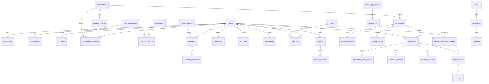

# Modelo de dados

> Banco PostgreSQL 16. Todas as alterações via Alembic.
> Este documento é a fonte para as migrações da Fase 1 em diante. Mudanças no modelo exigem atualizar este arquivo no mesmo PR.

## 1. Convenções

| Item | Regra |
| --- | --- |
| Nomes | Inglês, `snake_case`, tabelas no plural |
| Chave primária | `id UUID`, gerado pela aplicação (UUID v7 quando disponível, para ordenação temporal; senão v4) |
| Datas | `TIMESTAMPTZ` sempre em UTC; a interface converte para `America/Sao_Paulo` ou fuso do usuário |
| Auditoria de linha | `created_at`, `updated_at` em todas as tabelas mutáveis |
| Exclusão | `deleted_at` (exclusão lógica) só onde indicado; dados pessoais excluídos por LGPD são **apagados ou anonimizados de fato** |
| Dinheiro | `INTEGER` em centavos + `currency CHAR(3)` (padrão `BRL`) |
| E-mail | `CITEXT` (comparação sem diferenciar maiúsculas) |
| Enums | Tipos `ENUM` do PostgreSQL criados por migração, ou `TEXT` com `CHECK` quando a lista muda com frequência |
| JSON | `JSONB` só para dados semiestruturados (respostas de IA, configuração); nada que precise de filtro frequente |
| Chaves estrangeiras | Sempre com índice; `ON DELETE` explícito em cada uma |
| Multiempresa | Tabelas de organização têm `organization_id NOT NULL` mesmo quando derivável, para RLS e índices |

Extensões: `citext`, `pg_trgm`, `unaccent`, `vector` (pgvector, Fase 6).

## 2. Diagrama de relacionamentos (visão geral)



## 3. Tabelas

Legenda: **PK** chave primária, **FK** chave estrangeira, **U** único, **NN** não nulo, **IX** indexado.

### 3.1 Usuários e autenticação

#### `users`
| Coluna | Tipo | Regras |
| --- | --- | --- |
| id | uuid | PK |
| email | citext | NN, U |
| email_verified_at | timestamptz | nulo até verificar |
| password_hash | text | NN (Argon2id, formato PHC) |
| full_name | varchar(160) | NN |
| phone | varchar(32) | opcional, E.164 |
| status | enum `user_status` (`active`, `suspended`, `pending_deletion`, `deleted`) | NN, padrão `active` |
| platform_role | enum `platform_role` (`none`, `support`, `admin`) | NN, padrão `none` |
| mfa_secret_encrypted | bytea | opcional (Fase 7, obrigatório para `admin`) |
| last_login_at | timestamptz | |
| locale | varchar(10) | padrão `pt-BR` |
| timezone | varchar(64) | padrão `America/Sao_Paulo` |
| created_at, updated_at | timestamptz | NN |
| deleted_at | timestamptz | |

Índices: `U(email)`, `IX(status)`.

#### `user_sessions`
| Coluna | Tipo | Regras |
| --- | --- | --- |
| id | uuid | PK |
| user_id | uuid | FK users ON DELETE CASCADE, IX |
| token_hash | bytea | NN, U (SHA-256 do token opaco; o token em si nunca é salvo) |
| created_at | timestamptz | NN |
| last_seen_at | timestamptz | NN |
| idle_expires_at | timestamptz | NN |
| absolute_expires_at | timestamptz | NN |
| revoked_at | timestamptz | |
| ip_address | inet | |
| user_agent | varchar(300) | |

#### `auth_tokens`
Tokens de uso único (verificação de e-mail, recuperação de senha, troca de e-mail).

| Coluna | Tipo | Regras |
| --- | --- | --- |
| id | uuid | PK |
| user_id | uuid | FK users ON DELETE CASCADE, IX |
| purpose | enum (`email_verification`, `password_reset`, `email_change`) | NN |
| token_hash | bytea | NN, U |
| payload | jsonb | ex.: novo e-mail na troca |
| expires_at | timestamptz | NN |
| used_at | timestamptz | |
| created_at | timestamptz | NN |

#### `login_attempts`
| Coluna | Tipo | Regras |
| --- | --- | --- |
| id | bigint identity | PK |
| email | citext | IX |
| ip_address | inet | IX |
| success | boolean | NN |
| created_at | timestamptz | NN, IX |

Retenção: 90 dias.

### 3.2 Perfil do candidato

#### `user_profiles` (1:1 com `users`)
| Coluna | Tipo | Regras |
| --- | --- | --- |
| user_id | uuid | PK, FK users ON DELETE CASCADE |
| headline | varchar(160) | ex.: "Analista de Marketplace" |
| summary | text | resumo profissional |
| city | varchar(120) | |
| state | char(2) | UF |
| country | char(2) | padrão `BR` |
| desired_roles | text[] | |
| desired_salary_min_cents | integer | |
| work_modes | text[] | valores: `remote`, `hybrid`, `onsite` |
| contract_types | text[] | `clt`, `pj`, `internship`, `apprentice`, `temporary`, `freelance` |
| availability | enum (`immediate`, `15_days`, `30_days`, `negotiable`) | |
| linkedin_url, portfolio_url | varchar(500) | validados como URL |
| talent_pool_visibility | enum (`private`, `visible_to_companies`) | NN, padrão `private` (exige consentimento) |
| open_to_work | boolean | NN, padrão `true` |
| completeness_score | smallint | calculado pelo serviço (0 a 100) |
| updated_at | timestamptz | NN |

Não coletar: data de nascimento, gênero, estado civil, raça, religião, foto obrigatória, CPF (até ser necessário). Ver SECURITY_AND_LGPD.md, seção 6.

#### `user_preferences`
| Coluna | Tipo | Regras |
| --- | --- | --- |
| user_id | uuid | PK, FK users ON DELETE CASCADE |
| notify_email_applications | boolean | padrão `true` |
| notify_email_messages | boolean | padrão `true` |
| notify_email_job_alerts | boolean | padrão `false` |
| marketing_emails | boolean | padrão `false` (consentimento) |
| default_resume_id | uuid | FK resumes ON DELETE SET NULL |
| updated_at | timestamptz | |

#### `experiences`
| Coluna | Tipo | Regras |
| --- | --- | --- |
| id | uuid | PK |
| user_id | uuid | FK users ON DELETE CASCADE, IX |
| company_name | varchar(200) | NN |
| title | varchar(200) | NN |
| employment_type | text | mesmos valores de `contract_types` |
| work_mode | text | |
| location | varchar(200) | |
| start_date | date | NN (dia 1 quando só houver mês) |
| end_date | date | nulo se atual |
| is_current | boolean | NN; `CHECK (is_current = (end_date IS NULL))` |
| description | text | |
| achievements | text[] | |
| source | enum `data_source` (`manual`, `ai_resume`, `ai_document`) | NN |
| source_document_id | uuid | FK documents ON DELETE SET NULL |
| position | smallint | ordem de exibição |
| created_at, updated_at | timestamptz | |

`CHECK (end_date IS NULL OR end_date >= start_date)`.

#### `education`
| Coluna | Tipo | Regras |
| --- | --- | --- |
| id | uuid | PK |
| user_id | uuid | FK users ON DELETE CASCADE, IX |
| institution | varchar(200) | NN |
| level | enum `education_level` (`fundamental`, `medio`, `tecnico`, `superior`, `pos_graduacao`, `mestrado`, `doutorado`, `outro`) | NN |
| course | varchar(200) | |
| status | enum (`completed`, `in_progress`, `incomplete`) | NN |
| start_date, end_date | date | |
| source | `data_source` | NN |
| source_document_id | uuid | FK documents ON DELETE SET NULL |
| created_at, updated_at | timestamptz | |

#### `certificates`
| Coluna | Tipo | Regras |
| --- | --- | --- |
| id | uuid | PK |
| user_id | uuid | FK users ON DELETE CASCADE, IX |
| course_name | varchar(300) | NN |
| institution | varchar(200) | |
| workload_hours | numeric(6,1) | `CHECK (workload_hours > 0)` |
| completed_on | date | |
| issued_on | date | |
| credential_code | varchar(120) | |
| credential_url | varchar(500) | |
| source | `data_source` | NN |
| source_document_id | uuid | FK documents ON DELETE SET NULL |
| created_at, updated_at | timestamptz | |

Índice parcial único para evitar duplicata: `U(user_id, lower(course_name), coalesce(institution,''), coalesce(completed_on,'1900-01-01'))`.

#### `skills` (catálogo global)
| Coluna | Tipo | Regras |
| --- | --- | --- |
| id | uuid | PK |
| name | varchar(120) | NN (forma de exibição) |
| normalized_name | varchar(120) | NN, U (minúsculas, sem acento) |
| category | enum (`hard`, `soft`, `tool`, `language`, `domain`) | NN |
| aliases | text[] | sinônimos ("Excel", "MS Excel") |
| created_at | timestamptz | |

Índice `GIN (normalized_name gin_trgm_ops)` para autocompletar.

#### `user_skills`
| Coluna | Tipo | Regras |
| --- | --- | --- |
| user_id | uuid | PK composta, FK users ON DELETE CASCADE |
| skill_id | uuid | PK composta, FK skills ON DELETE RESTRICT |
| level | enum (`basic`, `intermediate`, `advanced`, `expert`) | |
| source | `data_source` | NN |
| evidence | jsonb | lista de `{type: certificate|experience, id}` |
| created_at | timestamptz | |

#### `certificate_skills`
`(certificate_id FK ON DELETE CASCADE, skill_id FK ON DELETE RESTRICT)`, PK composta.

#### `user_languages`
`(user_id, language CHAR(2) ISO 639-1, level enum (basic, intermediate, advanced, fluent, native))`, PK `(user_id, language)`.

#### `saved_answers`
Respostas reutilizáveis a perguntas de candidatura (herdado do painel atual).

| Coluna | Tipo | Regras |
| --- | --- | --- |
| id | uuid | PK |
| user_id | uuid | FK users ON DELETE CASCADE |
| question_key | varchar(500) | NN (pergunta normalizada) |
| question_text | varchar(1000) | NN |
| answer | text | NN |
| updated_at | timestamptz | |

`U(user_id, question_key)`.

### 3.3 Documentos

#### `upload_batches`
| Coluna | Tipo | Regras |
| --- | --- | --- |
| id | uuid | PK |
| user_id | uuid | FK users ON DELETE CASCADE, IX |
| status | enum (`uploading`, `processing`, `needs_review`, `completed`, `failed`) | NN |
| total_files | smallint | NN |
| processed_files | smallint | NN, padrão 0 |
| failed_files | smallint | NN, padrão 0 |
| created_at, updated_at | timestamptz | |

#### `documents`
| Coluna | Tipo | Regras |
| --- | --- | --- |
| id | uuid | PK |
| owner_user_id | uuid | FK users ON DELETE CASCADE, IX; nulo só para documentos de organização |
| organization_id | uuid | FK organizations ON DELETE CASCADE, IX; nulo para documentos pessoais |
| upload_batch_id | uuid | FK upload_batches ON DELETE SET NULL |
| parent_document_id | uuid | FK documents (arquivo extraído de um ZIP) |
| kind | enum `document_kind` (`unknown`, `resume`, `certificate`, `diploma`, `transcript`, `other`, `company_logo`, `company_verification`, `data_export`) | NN |
| storage_key | varchar(500) | NN, U |
| original_filename | varchar(255) | NN |
| mime_type | varchar(100) | NN (detectado, não o informado) |
| size_bytes | bigint | NN |
| sha256 | bytea | NN |
| page_count | smallint | |
| has_text_layer | boolean | |
| text_content | text | texto extraído (criptografia em repouso do provedor; ver SECURITY_AND_LGPD.md) |
| status | enum `document_status` (`pending_upload`, `quarantined`, `validating`, `rejected`, `processing`, `needs_review`, `confirmed`, `failed`) | NN |
| error_code | varchar(60) | |
| retention_until | timestamptz | |
| created_at, updated_at | timestamptz | |
| deleted_at | timestamptz | |

`CHECK ((owner_user_id IS NULL) <> (organization_id IS NULL))` (exatamente um dono).
Índice `U(owner_user_id, sha256) WHERE deleted_at IS NULL` para detectar arquivo repetido.

#### `document_extractions`
| Coluna | Tipo | Regras |
| --- | --- | --- |
| id | uuid | PK |
| document_id | uuid | FK documents ON DELETE CASCADE, IX |
| agent | varchar(40) | NN (`cv_agent`, `document_agent`) |
| schema_version | varchar(20) | NN |
| payload | jsonb | NN (dados extraídos, com trechos de origem e confiança por campo) |
| overall_confidence | numeric(3,2) | 0 a 1 |
| status | enum (`pending_review`, `accepted`, `partially_accepted`, `discarded`) | NN |
| reviewed_at | timestamptz | |
| ai_interaction_id | uuid | FK ai_interactions ON DELETE SET NULL |
| created_at | timestamptz | |

### 3.4 Currículos

#### `resumes`
| Coluna | Tipo | Regras |
| --- | --- | --- |
| id | uuid | PK |
| user_id | uuid | FK users ON DELETE CASCADE, IX |
| title | varchar(160) | NN (ex.: "Currículo Marketplace") |
| is_base | boolean | NN, padrão `false` |
| source_document_id | uuid | FK documents ON DELETE SET NULL (quando nasceu de um PDF enviado) |
| current_version_id | uuid | FK resume_versions ON DELETE SET NULL (FK adiada) |
| archived_at | timestamptz | |
| created_at, updated_at | timestamptz | |

#### `resume_versions`
Versões imutáveis. Editar cria nova versão.

| Coluna | Tipo | Regras |
| --- | --- | --- |
| id | uuid | PK |
| resume_id | uuid | FK resumes ON DELETE CASCADE |
| version_number | integer | NN |
| content | jsonb | NN (estrutura do currículo: contato, resumo, experiências, formação, cursos, competências, idiomas) |
| template_key | varchar(40) | NN, padrão `classic` |
| target_job_posting_id | uuid | FK job_postings ON DELETE SET NULL |
| target_external_job_id | uuid | FK external_jobs ON DELETE SET NULL |
| created_by | enum (`user`, `ai`) | NN |
| ai_interaction_id | uuid | FK ai_interactions ON DELETE SET NULL |
| rendered_document_id | uuid | FK documents ON DELETE SET NULL (PDF gerado) |
| created_at | timestamptz | NN |

`U(resume_id, version_number)`.

#### `ats_analyses`
| Coluna | Tipo | Regras |
| --- | --- | --- |
| id | uuid | PK |
| user_id | uuid | FK users ON DELETE CASCADE, IX |
| resume_version_id | uuid | FK resume_versions ON DELETE CASCADE |
| job_posting_id | uuid | FK job_postings ON DELETE SET NULL |
| external_job_id | uuid | FK external_jobs ON DELETE SET NULL |
| score | smallint | 0 a 100 |
| report | jsonb | NN (critérios, pontos fortes, lacunas, sugestões) |
| ai_interaction_id | uuid | FK ai_interactions |
| created_at | timestamptz | |

### 3.5 Organizações e permissões

#### `organizations`
| Coluna | Tipo | Regras |
| --- | --- | --- |
| id | uuid | PK |
| name | varchar(200) | NN (nome fantasia exibido) |
| slug | varchar(80) | NN, U (`^[a-z0-9-]{3,80}$`) |
| cnpj | char(14) | U quando não nulo, só dígitos, validado por dígito verificador |
| verification_status | enum (`unverified`, `pending`, `verified`, `rejected`) | NN, padrão `unverified` |
| verified_at | timestamptz | |
| status | enum (`active`, `suspended`, `pending_deletion`) | NN |
| created_by_user_id | uuid | FK users ON DELETE SET NULL |
| created_at, updated_at | timestamptz | |
| deleted_at | timestamptz | |

#### `company_profiles` (1:1)
| Coluna | Tipo | Regras |
| --- | --- | --- |
| organization_id | uuid | PK, FK organizations ON DELETE CASCADE |
| legal_name | varchar(250) | razão social |
| description | text | |
| website | varchar(300) | |
| industry | varchar(120) | |
| size_range | enum (`1_10`, `11_50`, `51_200`, `201_500`, `501_1000`, `1000_plus`) | |
| city | varchar(120) | |
| state | char(2) | |
| logo_document_id | uuid | FK documents ON DELETE SET NULL |
| public_email_domain | varchar(200) | domínio corporativo (ajuda na verificação) |
| updated_at | timestamptz | |

#### `company_verifications`
| Coluna | Tipo | Regras |
| --- | --- | --- |
| id | uuid | PK |
| organization_id | uuid | FK organizations ON DELETE CASCADE, IX |
| method | enum (`cnpj_registry`, `email_domain`, `manual_documents`) | NN |
| status | enum (`pending`, `approved`, `rejected`) | NN |
| evidence | jsonb | dados da consulta de CNPJ, domínio confirmado, IDs de documentos |
| reviewed_by_user_id | uuid | FK users |
| reviewed_at | timestamptz | |
| notes | text | |
| created_at | timestamptz | |

#### `permissions` (catálogo fixo, semeado por migração)
| Coluna | Tipo |
| --- | --- |
| key | varchar(80) PK (ex.: `jobs.publish`) |
| description | varchar(300) |
| scope | enum (`organization`, `platform`) |

#### `organization_roles`
| Coluna | Tipo | Regras |
| --- | --- | --- |
| id | uuid | PK |
| organization_id | uuid | FK organizations ON DELETE CASCADE; **nulo = papel de sistema** |
| key | varchar(60) | NN (`owner`, `admin`, `hiring_manager`, `recruiter`, `viewer` ou personalizado) |
| name | varchar(100) | NN |
| is_system | boolean | NN |
| created_at | timestamptz | |

`U(organization_id, key)` (com `NULLS NOT DISTINCT`).

#### `role_permissions`
`(role_id FK ON DELETE CASCADE, permission_key FK permissions)`, PK composta.

#### `organization_members`
| Coluna | Tipo | Regras |
| --- | --- | --- |
| id | uuid | PK |
| organization_id | uuid | FK organizations ON DELETE CASCADE, IX |
| user_id | uuid | FK users ON DELETE CASCADE, IX |
| role_id | uuid | FK organization_roles ON DELETE RESTRICT |
| status | enum (`active`, `suspended`, `removed`) | NN |
| job_scope | enum (`all_jobs`, `assigned_jobs`) | NN, padrão `all_jobs` |
| joined_at | timestamptz | |
| removed_at | timestamptz | |

`U(organization_id, user_id)`. Regra no serviço: toda organização tem pelo menos um membro ativo com papel `owner`.

#### `organization_invitations`
| Coluna | Tipo | Regras |
| --- | --- | --- |
| id | uuid | PK |
| organization_id | uuid | FK ON DELETE CASCADE |
| email | citext | NN |
| role_id | uuid | FK organization_roles |
| token_hash | bytea | NN, U |
| invited_by_user_id | uuid | FK users |
| expires_at | timestamptz | NN (7 dias) |
| accepted_at, revoked_at | timestamptz | |
| created_at | timestamptz | |

`U(organization_id, email) WHERE accepted_at IS NULL AND revoked_at IS NULL`.

### 3.6 Vagas próprias

#### `job_postings`
| Coluna | Tipo | Regras |
| --- | --- | --- |
| id | uuid | PK |
| organization_id | uuid | FK organizations ON DELETE CASCADE, IX |
| created_by_user_id | uuid | FK users ON DELETE SET NULL |
| status | enum `job_status` (`draft`, `published`, `paused`, `closed`, `archived`) | NN |
| title | varchar(200) | NN |
| slug | varchar(220) | NN; `U(organization_id, slug)` |
| area | varchar(120) | área profissional |
| seniority | enum (`intern`, `junior`, `mid`, `senior`, `specialist`, `manager`, `director`, `not_specified`) | |
| openings | smallint | NN, `CHECK (openings > 0)` |
| work_mode | enum (`remote`, `hybrid`, `onsite`) | NN |
| city | varchar(120) | obrigatório se `hybrid` ou `onsite` |
| state | char(2) | |
| remote_scope | enum (`brazil`, `state`, `worldwide`) | |
| contract_type | enum (`clt`, `pj`, `internship`, `apprentice`, `temporary`, `freelance`) | NN |
| salary_min_cents | integer | |
| salary_max_cents | integer | `CHECK (salary_max_cents >= salary_min_cents)` |
| salary_period | enum (`month`, `hour`, `year`) | |
| show_salary | boolean | NN, padrão `true` |
| description | text | NN |
| responsibilities | text[] | |
| benefits | text[] | |
| education_level_min | `education_level` | |
| experience_years_min | smallint | |
| selection_process | jsonb | etapas informadas pela empresa |
| ai_draft_id | uuid | FK job_drafts ON DELETE SET NULL |
| published_at | timestamptz | |
| closes_at | timestamptz | |
| closed_at | timestamptz | |
| close_reason | enum (`filled`, `canceled`, `expired`, `other`) | |
| search_vector | tsvector | gerado (título A, requisitos B, descrição C) |
| embedding | vector(…) | Fase 6 |
| created_at, updated_at | timestamptz | |

Índices: `IX(organization_id, status)`, `GIN(search_vector)`, `IX(status, published_at DESC) WHERE status = 'published'`, `GIN(title gin_trgm_ops)`.

#### `job_requirements`
| Coluna | Tipo | Regras |
| --- | --- | --- |
| id | uuid | PK |
| job_posting_id | uuid | FK ON DELETE CASCADE, IX |
| organization_id | uuid | NN (para RLS) |
| importance | enum (`required`, `desirable`) | NN |
| category | enum (`skill`, `tool`, `education`, `language`, `certification`, `experience`, `other`) | NN |
| description | varchar(300) | NN |
| skill_id | uuid | FK skills ON DELETE SET NULL |
| position | smallint | |

#### `screening_questions`
| Coluna | Tipo | Regras |
| --- | --- | --- |
| id | uuid | PK |
| job_posting_id | uuid | FK ON DELETE CASCADE |
| organization_id | uuid | NN |
| question | varchar(500) | NN |
| answer_type | enum (`text`, `yes_no`, `single_choice`, `number`) | NN |
| options | text[] | |
| required | boolean | NN |
| position | smallint | |

Proibido perguntar sobre características protegidas (RN-REC-05).

#### `job_drafts` (sessões do criador de vagas por IA)
| Coluna | Tipo | Regras |
| --- | --- | --- |
| id | uuid | PK |
| organization_id | uuid | FK ON DELETE CASCADE |
| created_by_user_id | uuid | FK users |
| answers | jsonb | NN (respostas às perguntas) |
| generated | jsonb | vaga gerada pela IA |
| status | enum (`collecting`, `generated`, `converted`, `abandoned`) | NN |
| ai_interaction_id | uuid | FK |
| created_at, updated_at | timestamptz | |

#### `job_team_members`
Recrutadores atribuídos a uma vaga (para `job_scope = assigned_jobs`).
`(job_posting_id FK ON DELETE CASCADE, member_id FK organization_members ON DELETE CASCADE, organization_id NN)`, PK `(job_posting_id, member_id)`.

#### `pipeline_stages`
| Coluna | Tipo | Regras |
| --- | --- | --- |
| id | uuid | PK |
| job_posting_id | uuid | FK ON DELETE CASCADE |
| organization_id | uuid | NN |
| name | varchar(80) | NN |
| kind | enum `stage_kind` (`applied`, `screening`, `interview`, `assessment`, `offer`, `hired`, `rejected`) | NN |
| position | smallint | NN |

Etapas padrão criadas com a vaga: Recebidos, Em análise, Pré-selecionados, Entrevista, Proposta, Contratados, Reprovados. `U(job_posting_id, position)`.

### 3.7 Vagas externas

#### `external_job_sources`
| Coluna | Tipo | Regras |
| --- | --- | --- |
| id | uuid | PK |
| key | varchar(40) | NN, U |
| name | varchar(100) | NN |
| type | enum (`public_api`, `feed`, `partner_api`) | NN |
| enabled | boolean | NN, padrão `false` |
| terms_url | varchar(500) | |
| terms_reviewed_at | timestamptz | `CHECK (NOT enabled OR terms_reviewed_at IS NOT NULL)` |
| attribution_text | varchar(200) | texto de crédito exigido pela fonte |
| fetch_interval_minutes | integer | NN, padrão 360 |
| config | jsonb | |
| last_run_at | timestamptz | |

#### `external_jobs`
| Coluna | Tipo | Regras |
| --- | --- | --- |
| id | uuid | PK |
| source_id | uuid | FK ON DELETE CASCADE |
| external_id | varchar(200) | NN |
| url | varchar(1500) | NN |
| title | varchar(300) | NN |
| company_name | varchar(250) | |
| location_raw | varchar(300) | |
| city | varchar(120) | |
| state | char(2) | |
| work_mode | enum (`remote`, `hybrid`, `onsite`, `unknown`) | NN |
| contract_type | text | normalizado quando possível |
| salary_raw | varchar(200) | |
| salary_min_cents, salary_max_cents | integer | só quando a moeda for BRL e o período for mensal |
| language | char(2) | |
| description | text | |
| posted_at | timestamptz | |
| first_seen_at, last_seen_at | timestamptz | NN |
| missed_runs | smallint | NN, padrão 0 |
| status | enum (`active`, `expired`, `removed`) | NN |
| fingerprint | char(64) | NN, IX |
| duplicate_of_id | uuid | FK external_jobs ON DELETE SET NULL |
| search_vector | tsvector | gerado |
| created_at, updated_at | timestamptz | |

`U(source_id, external_id)`, `GIN(search_vector)`, `IX(status, posted_at DESC)`.

#### `external_job_import_runs`
`id, source_id, started_at, finished_at, status (running|succeeded|failed), fetched, inserted, updated, expired, duplicates, errors jsonb`.

### 3.8 Candidaturas

#### `applications` (só para vagas próprias)
| Coluna | Tipo | Regras |
| --- | --- | --- |
| id | uuid | PK |
| job_posting_id | uuid | FK job_postings ON DELETE RESTRICT, IX |
| organization_id | uuid | NN, IX (cópia para RLS) |
| candidate_user_id | uuid | FK users ON DELETE SET NULL, IX (nulo após exclusão da conta, com dados anonimizados) |
| resume_version_id | uuid | FK resume_versions ON DELETE SET NULL |
| current_stage_id | uuid | FK pipeline_stages ON DELETE RESTRICT |
| status | enum `application_status` (`submitted`, `in_review`, `shortlisted`, `interviewing`, `offer`, `hired`, `rejected`, `withdrawn`) | NN |
| candidate_snapshot | jsonb | NN: cópia imutável dos dados enviados (nome, contato, resumo, experiências, formação, competências) |
| screening_answers | jsonb | |
| cover_letter | text | |
| consent_id | uuid | FK consents (compartilhamento com a empresa) |
| submitted_at | timestamptz | NN |
| withdrawn_at | timestamptz | |
| decided_at | timestamptz | |
| retention_until | timestamptz | NN |
| created_at, updated_at | timestamptz | |

`U(job_posting_id, candidate_user_id)`. Índice `IX(organization_id, job_posting_id, status)`.

**Por que snapshot:** a empresa precisa ver exatamente o que foi enviado, mesmo que o candidato edite o perfil depois. O candidato pode retirar a candidatura (RN-APP-06).

#### `application_status_history` (só inserção)
| Coluna | Tipo | Regras |
| --- | --- | --- |
| id | uuid | PK |
| application_id | uuid | FK ON DELETE CASCADE, IX |
| organization_id | uuid | NN |
| from_stage_id, to_stage_id | uuid | FK pipeline_stages |
| from_status, to_status | `application_status` | |
| changed_by_user_id | uuid | FK users ON DELETE SET NULL |
| reason | varchar(500) | |
| visible_to_candidate | boolean | NN |
| created_at | timestamptz | NN |

#### `candidate_reviews` (privado da organização)
`id, application_id FK CASCADE, organization_id NN, reviewer_user_id FK, rating smallint CHECK 1..5, notes text, created_at, updated_at`.

#### `application_ai_summaries`
`id, application_id FK CASCADE, organization_id NN, match_score smallint, breakdown jsonb (requisito a requisito, com evidência), summary text, model_info jsonb, ai_interaction_id FK, created_at`. Sempre exibido com o aviso de apoio à decisão.

#### `interview_schedules`
| Coluna | Tipo | Regras |
| --- | --- | --- |
| id | uuid | PK |
| application_id | uuid | FK ON DELETE CASCADE, IX |
| organization_id | uuid | NN |
| scheduled_by_user_id | uuid | FK users |
| starts_at, ends_at | timestamptz | NN, `CHECK (ends_at > starts_at)` |
| timezone | varchar(64) | NN |
| mode | enum (`video`, `phone`, `onsite`) | NN |
| location_or_link | varchar(500) | |
| status | enum (`proposed`, `confirmed`, `rescheduled`, `canceled`, `completed`, `no_show`) | NN |
| candidate_response_at | timestamptz | |
| notes_internal | text | só a organização vê |
| created_at, updated_at | timestamptz | |

#### `saved_jobs`
| Coluna | Tipo | Regras |
| --- | --- | --- |
| id | uuid | PK |
| user_id | uuid | FK users ON DELETE CASCADE |
| job_posting_id | uuid | FK ON DELETE CASCADE |
| external_job_id | uuid | FK ON DELETE CASCADE |
| created_at | timestamptz | |

`CHECK (num_nonnulls(job_posting_id, external_job_id) = 1)`, únicos parciais por usuário e vaga.

#### `external_application_trackers`
Acompanhamento de candidaturas feitas pelo candidato em sites de terceiros.

| Coluna | Tipo | Regras |
| --- | --- | --- |
| id | uuid | PK |
| user_id | uuid | FK users ON DELETE CASCADE |
| external_job_id | uuid | FK external_jobs ON DELETE SET NULL |
| job_title, company_name, url | varchar | cópia, para não perder se a vaga expirar |
| resume_version_id | uuid | FK resume_versions ON DELETE SET NULL |
| status | enum (`started`, `applied_confirmed_by_user`, `interview`, `offer`, `rejected`, `closed`) | NN |
| applied_at | timestamptz | informado pelo usuário |
| notes | text | |
| created_at, updated_at | timestamptz | |

### 3.9 Comunicação

#### `conversations`
`id, application_id FK CASCADE U, organization_id NN, candidate_user_id FK SET NULL, last_message_at, created_at`. Uma conversa por candidatura (RN-MSG-01).

#### `messages`
| Coluna | Tipo | Regras |
| --- | --- | --- |
| id | uuid | PK |
| conversation_id | uuid | FK ON DELETE CASCADE, IX |
| organization_id | uuid | NN |
| sender_user_id | uuid | FK users ON DELETE SET NULL |
| sender_side | enum (`candidate`, `organization`, `system`) | NN |
| body | text | NN, até 5.000 caracteres |
| attachment_document_ids | uuid[] | |
| read_by_candidate_at | timestamptz | |
| read_by_organization_at | timestamptz | |
| created_at | timestamptz | NN |

#### `notifications`
`id, user_id FK CASCADE IX, organization_id (opcional), type varchar(60), payload jsonb, read_at, emailed_at, created_at`. Índice `IX(user_id, read_at, created_at DESC)`.

### 3.10 Inteligência artificial

#### `ai_interactions`
| Coluna | Tipo | Regras |
| --- | --- | --- |
| id | uuid | PK |
| user_id | uuid | FK users ON DELETE SET NULL, IX |
| organization_id | uuid | FK organizations ON DELETE SET NULL, IX |
| agent | varchar(40) | NN |
| operation | varchar(60) | NN |
| provider | varchar(40) | NN |
| model | varchar(80) | NN |
| prompt_version | varchar(20) | NN |
| input_tokens, output_tokens | integer | |
| cost_microcents | bigint | custo estimado |
| latency_ms | integer | |
| status | enum (`succeeded`, `failed`, `schema_error`, `blocked`, `timeout`) | NN |
| error_code | varchar(60) | |
| input_fingerprint | char(64) | hash da entrada (para cache e depuração sem guardar o conteúdo) |
| output | jsonb | saída validada; apagada junto com o dado de origem |
| created_at | timestamptz | NN, IX |

O texto enviado ao modelo **não é armazenado** por padrão. Retenção dos registros: 12 meses (os campos `output` seguem a retenção do dado de origem).

#### `usage_counters`
Contadores para limites de plano (IA e demais recursos).

| Coluna | Tipo | Regras |
| --- | --- | --- |
| id | uuid | PK |
| user_id | uuid | FK, nulo se for de organização |
| organization_id | uuid | FK, nulo se for de usuário |
| feature_key | varchar(60) | NN (ex.: `ai.ats_analysis`, `documents.processed`) |
| period | char(7) | NN (`2026-11`) |
| count | integer | NN |
| cost_microcents | bigint | NN, padrão 0 |

`CHECK (num_nonnulls(user_id, organization_id) = 1)`, `U(user_id, organization_id, feature_key, period) NULLS NOT DISTINCT`. Incremento atômico com `INSERT ... ON CONFLICT DO UPDATE`.

### 3.11 Monetização

#### `plans`
| Coluna | Tipo | Regras |
| --- | --- | --- |
| id | uuid | PK |
| key | varchar(40) | NN, U (`candidate_free`, `candidate_pro`, `company_start`, `company_pro`, `company_business`) |
| audience | enum (`candidate`, `company`) | NN |
| name | varchar(80) | NN |
| price_cents | integer | NN |
| currency | char(3) | NN, `BRL` |
| billing_interval | enum (`month`, `year`) | NN |
| limits | jsonb | NN (ver BUSINESS_RULES.md, seção 9) |
| provider_plan_id | varchar(100) | ID do plano no Mercado Pago |
| is_active | boolean | NN |
| created_at, updated_at | timestamptz | |

Alterar preço cria um novo plano (ou nova versão); assinaturas existentes mantêm o preço contratado até a migração ser comunicada (RN-BIL-07).

#### `subscriptions`
| Coluna | Tipo | Regras |
| --- | --- | --- |
| id | uuid | PK |
| user_id | uuid | FK, para plano de candidato |
| organization_id | uuid | FK, para plano de empresa |
| plan_id | uuid | FK plans ON DELETE RESTRICT |
| status | enum `subscription_status` (`pending`, `active`, `past_due`, `canceled`, `expired`) | NN |
| provider | varchar(30) | NN, `mercadopago` |
| provider_subscription_id | varchar(100) | U |
| current_period_start, current_period_end | timestamptz | |
| grace_until | timestamptz | |
| cancel_at_period_end | boolean | NN, padrão `false` |
| canceled_at | timestamptz | |
| created_at, updated_at | timestamptz | |

`CHECK (num_nonnulls(user_id, organization_id) = 1)`. Índice único parcial: no máximo uma assinatura `active` ou `past_due` por titular.

#### `payments`
`id, subscription_id FK, provider_payment_id varchar U, amount_cents, currency, status (pending|approved|rejected|refunded|charged_back), status_detail, paid_at, raw jsonb (sem dados de cartão), created_at`.

#### `webhook_events`
| Coluna | Tipo | Regras |
| --- | --- | --- |
| id | uuid | PK |
| provider | varchar(30) | NN |
| provider_event_id | varchar(150) | NN |
| topic | varchar(80) | NN |
| payload | jsonb | NN |
| signature_valid | boolean | NN |
| status | enum (`received`, `processed`, `failed`, `ignored`) | NN |
| attempts | smallint | NN |
| last_error | text | |
| received_at, processed_at | timestamptz | |

`U(provider, provider_event_id, topic)` garante idempotência.

### 3.12 LGPD e auditoria

#### `legal_documents`
`id, type (terms|privacy|cookies|dpa), version varchar(20), content_markdown, published_at, U(type, version)`.

#### `consents`
| Coluna | Tipo | Regras |
| --- | --- | --- |
| id | uuid | PK |
| user_id | uuid | FK users ON DELETE CASCADE, IX |
| purpose | enum (`terms_acceptance`, `privacy_acceptance`, `talent_pool_visibility`, `share_with_company`, `marketing_emails`, `ai_processing_documents`) | NN |
| legal_basis | enum (`consent`, `contract`, `legal_obligation`, `legitimate_interest`) | NN |
| legal_document_id | uuid | FK legal_documents |
| organization_id | uuid | quando o consentimento é para uma empresa específica |
| granted_at | timestamptz | NN |
| revoked_at | timestamptz | |
| ip_address | inet | |
| user_agent | varchar(300) | |

#### `data_subject_requests`
`id, user_id FK SET NULL, type (export|deletion|correction|access_info), status (received|in_progress|completed|rejected), requested_at, due_at, completed_at, result_document_id, notes`.

#### `audit_logs` (só inserção; papel da aplicação sem `UPDATE`/`DELETE`)
| Coluna | Tipo | Regras |
| --- | --- | --- |
| id | bigint identity | PK |
| occurred_at | timestamptz | NN, IX |
| actor_user_id | uuid | IX |
| actor_platform_role | `platform_role` | |
| organization_id | uuid | IX |
| action | varchar(80) | NN (ex.: `document.download`, `member.role_changed`, `admin.document_access`) |
| target_type | varchar(40) | |
| target_id | uuid | |
| justification | varchar(500) | obrigatório em acesso administrativo a dado privado |
| ip_address | inet | |
| user_agent | varchar(300) | |
| metadata | jsonb | sem dados pessoais desnecessários |

Particionamento mensal quando passar de alguns milhões de linhas. Retenção: 5 anos para ações administrativas e de segurança; 6 meses mínimos para registros de acesso à aplicação (Marco Civil da Internet, art. 15).

## 4. Isolamento e Row Level Security

### 4.1 Estratégia

Banco compartilhado, esquema único, coluna de dono em cada tabela (`user_id` ou `organization_id`). Três barreiras:

1. **Aplicação:** repositories sempre filtram pelo dono recebido do contexto autenticado.
2. **RLS no PostgreSQL:** políticas usam variáveis de sessão definidas no início de cada transação.
3. **Testes de isolamento automatizados** (seção 6).

### 4.2 Papéis do banco

| Papel | Uso | Permissões |
| --- | --- | --- |
| `vagas_owner` | dono do esquema, só para migrações | tudo |
| `vagas_app` | conexões da API e dos workers | `SELECT/INSERT/UPDATE/DELETE` nas tabelas, **sem** `SUPERUSER` e **sem** `BYPASSRLS`; só `INSERT` em `audit_logs`. A API verifica isso ao iniciar e não sobe se o papel for privilegiado |
| `vagas_readonly` | relatórios e suporte técnico | `SELECT` com RLS |

### 4.3 Variáveis de contexto

No início de cada transação, a API executa:

```sql
SELECT set_config('app.user_id', :user_id, true);
SELECT set_config('app.org_id', :org_id_or_empty, true);
SELECT set_config('app.platform_role', :role, true);
```

O terceiro parâmetro `true` limita o valor à transação, evitando vazamento entre requisições no pool de conexões.

### 4.4 Exemplos de políticas

```sql
-- Dados pessoais: só o dono
ALTER TABLE certificates ENABLE ROW LEVEL SECURITY;
ALTER TABLE certificates FORCE ROW LEVEL SECURITY;
CREATE POLICY certificates_owner ON certificates
  USING (user_id = current_setting('app.user_id', true)::uuid)
  WITH CHECK (user_id = current_setting('app.user_id', true)::uuid);

-- Dados de organização: só membros ativos da organização do contexto
CREATE POLICY job_postings_org ON job_postings
  USING (organization_id = nullif(current_setting('app.org_id', true), '')::uuid
         AND app_is_active_member(organization_id));

-- Vagas publicadas: leitura pública
CREATE POLICY job_postings_public_read ON job_postings FOR SELECT
  USING (status = 'published');

-- Candidaturas: candidato vê as próprias; organização vê as suas
CREATE POLICY applications_candidate ON applications FOR SELECT
  USING (candidate_user_id = current_setting('app.user_id', true)::uuid);
CREATE POLICY applications_org ON applications
  USING (organization_id = nullif(current_setting('app.org_id', true), '')::uuid
         AND app_is_active_member(organization_id));
```

`app_is_active_member(org uuid)` é uma função `SECURITY DEFINER` que consulta `organization_members` com o `app.user_id` atual.

Tarefas de sistema (importação de vagas, retenção) rodam com contexto `app.platform_role = 'system'` e políticas específicas, nunca com `BYPASSRLS` no papel da aplicação.

### 4.5 Tabelas sem RLS

Catálogos públicos ou sem dado pessoal: `permissions`, `skills`, `plans`, `legal_documents`, `external_job_sources`, `external_jobs`, `external_job_import_runs`.

## 5. Retenção (resumo)

| Dado | Retenção |
| --- | --- |
| Conta inativa | aviso após 24 meses sem login; exclusão 30 dias depois do aviso, se não houver retorno |
| Documentos e currículos | enquanto a conta existir ou até o usuário excluir |
| Candidatura | até 12 meses após o encerramento da vaga, depois anonimizada (campo `retention_until`) |
| Uploads em quarentena não confirmados | 24 h |
| Exportações LGPD | 7 dias |
| `login_attempts` | 90 dias |
| Registros de acesso à aplicação | 6 meses (mínimo legal) |
| `audit_logs` de segurança e administração | 5 anos |
| `ai_interactions` (metadados) | 12 meses |
| Pagamentos | 5 anos (obrigações fiscais; confirmar com contador) |

Detalhes e bases legais em SECURITY_AND_LGPD.md.

## 6. Testes obrigatórios do modelo

1. `alembic upgrade head` em banco vazio e `alembic downgrade -1` da última migração sem erro.
2. `alembic check` sem diferenças entre modelos e migrações.
3. Para cada tabela com RLS: teste que usuário A não lê, não altera e não apaga registro de B, consultando o banco diretamente com o papel `vagas_app` (o mesmo da aplicação; nunca com o papel de migração).
4. Para cada tabela de organização: membro da organização X não acessa dados de Y; membro removido perde acesso imediatamente.
5. Restrições `CHECK` e únicas testadas com casos válidos e inválidos.

## 7. Sementes

- Migração de dados semeia: `permissions`, papéis de sistema e suas permissões, `plans` iniciais (inativos até aprovação dos preços), `legal_documents` em rascunho.
- Dados fictícios de desenvolvimento ficam em `backend/scripts/seed_dev.py`, nunca em migração, e todos os registros usam domínio `@exemplo.invalid`.
