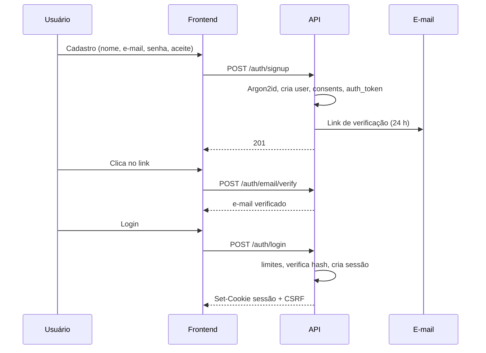

# Segurança e LGPD

> Requisitos de segurança, fluxos de autenticação e adequação à Lei Geral de Proteção de Dados (Lei nº 13.709/2018).
> **Aviso:** este documento organiza requisitos técnicos e boas práticas. Termos de uso, política de privacidade, papéis de controlador e operador e prazos legais devem ser revisados por advogado antes do lançamento público.

## 1. Modelo de ameaças (resumo)

| Ameaça | Exemplo | Controles principais |
| --- | --- | --- |
| Acesso a dados de outro tenant | Recrutador da empresa A troca o ID na URL e vê candidatos da empresa B | Contexto na URL validado, repositories com dono obrigatório, RLS, testes de isolamento, 404 para recurso alheio |
| Roubo de conta | Senha vazada, força bruta | Argon2id, limites de tentativa, sessões revogáveis, aviso de novo login, MFA para equipe interna |
| Sequestro de sessão | XSS lendo token | Cookie HttpOnly, CSP restritiva, nada em `localStorage` |
| Ações forjadas | Site malicioso faz o navegador do usuário publicar vaga | SameSite=Lax + token CSRF |
| Arquivo malicioso | PDF com script, ZIP bomb, executável renomeado | Validação por assinatura, limites, quarentena, antivírus [D-08] |
| Vazamento de documentos | URL de currículo compartilhada | Bucket privado, URL assinada de 5 min, auditoria de downloads |
| Abuso de IA | Injeção de instruções em currículo; uso para gerar custo | Delimitação, saída só JSON, limites por plano e teto global |
| Fraude de empresa | Empresa falsa publicando vagas para coletar dados | Verificação de CNPJ, denúncia de vaga, moderação, limites antes da verificação |
| Webhook falso | Alguém simula pagamento aprovado | Assinatura HMAC + consulta do recurso na API do Mercado Pago |
| Abuso administrativo | Funcionário da plataforma lendo currículos | Acesso com justificativa, temporário, auditado e visível ao titular |
| Injeção SQL | Filtros de busca | SQLAlchemy com parâmetros; nenhuma concatenação de SQL com entrada |

Referência de verificação: OWASP ASVS nível 2.

## 2. Autenticação

### 2.1 Senhas

- Hash **Argon2id** (`argon2-cffi`), parâmetros iniciais: memória 64 MiB, 3 iterações, paralelismo 2; recalibrar para cerca de 250 ms no servidor de produção. Rehash automático no login quando os parâmetros mudarem.
- Mínimo de 10 caracteres, máximo de 128, sem regras de composição obrigatória; recusar senhas da lista das mais comuns e senhas que contenham o e-mail ou o nome.
- Comparações em tempo constante; mensagens genéricas para não revelar se o e-mail existe.

### 2.2 Sessões

Recomendação **[D-03]:** sessão opaca no servidor (não JWT).

| Item | Valor |
| --- | --- |
| Token | 32 bytes aleatórios (`secrets.token_urlsafe`), guardado só como SHA-256 em `user_sessions` |
| Cookie | `vagas_session`, `HttpOnly`, `Secure`, `SameSite=Lax`, `Path=/` |
| Expiração por inatividade | 12 horas (30 dias com "manter conectado") |
| Expiração absoluta | 30 dias |
| Renovação | `last_seen_at` atualizado no máximo a cada 5 min; novo token gerado após login e após troca de senha |
| Revogação | logout, logout de todos os dispositivos, troca e redefinição de senha, suspensão da conta, exclusão |
| Cache | sessão válida em cache no Key Value por 60 s para não consultar o banco a cada requisição |

### 2.3 Fluxos



| Fluxo | Regras |
| --- | --- |
| Cadastro | aceite de termos e privacidade obrigatório e registrado com versão, data e IP; e-mail de verificação válido por 24 h; resposta idêntica exista ou não o e-mail, e-mail só pela fila e aviso de tentativa limitado a 1 por endereço a cada 24 h (API_SPECIFICATION.md, contrato de `POST /auth/signup`) |
| Verificação de e-mail | token de uso único; reenvio no máximo 1 a cada 60 s; sem verificação, a conta existe mas não pode candidatar nem publicar |
| Login | 5 tentativas por minuto por IP + e-mail; após 10 falhas seguidas no mesmo e-mail, atraso progressivo e e-mail de alerta ao titular |
| Novo dispositivo | e-mail "novo acesso à sua conta" com opção de encerrar a sessão |
| Esqueci a senha | resposta sempre igual; link válido por 1 h, uso único; ao redefinir, todas as sessões são revogadas e o titular recebe aviso |
| Troca de e-mail | confirmação no novo endereço; aviso no antigo com link para reverter por 7 dias |
| Convite para empresa | link válido por 7 dias; só aceito por conta com o mesmo e-mail; quem não tem conta faz cadastro antes |
| MFA (TOTP) | obrigatório para `platform_role` diferente de `none` na Fase 7; opcional para os demais depois do MVP |
| Login social (Google, LinkedIn) | fora do MVP **[D-02]** |

## 3. Autorização

Ver [PERMISSIONS.md](PERMISSIONS.md). Resumo: permissão verificada no backend em todo endpoint; recurso de outro dono retorna 404; RLS como segunda barreira.

## 4. Proteções da aplicação web

| Controle | Configuração |
| --- | --- |
| HTTPS | obrigatório (Render fornece TLS); `Strict-Transport-Security: max-age=31536000; includeSubDomains` |
| CSP | `default-src 'self'`; `script-src 'self' 'nonce-…'`; `connect-src 'self'` **+ somente o endpoint exato do bucket do ambiente** (para o upload direto, seção 4.2); `img-src 'self' data:` + domínio público de logos, se existir; `form-action 'self'`; `frame-ancestors 'none'`; `object-src 'none'`; `base-uri 'self'` |
| Cabeçalhos | `X-Content-Type-Options: nosniff`, `Referrer-Policy: strict-origin-when-cross-origin`, `Permissions-Policy` restritiva |
| CSRF | token duplo em métodos que alteram estado |
| CORS da API | desligado (mesma origem via proxy, D-10) |
| CORS do bucket | só a origem exata do frontend do ambiente (seção 4.2) |
| Entrada | validação Pydantic com tamanhos máximos em todo campo de texto |
| Saída | React escapa por padrão; proibido `dangerouslySetInnerHTML` sem sanitização (descrições de vaga em Markdown são renderizadas com sanitizador) |
| Redirecionamentos | só para caminhos internos ou lista permitida |
| Dependências | `pip-audit`, `npm audit` e Dependabot; atualização de segurança em até 7 dias para falhas críticas |
| Segredos | só em variáveis de ambiente do Render; `.env` no `.gitignore`; varredura com gitleaks no CI |
| Conexão com o banco | ver seção 4.3 |

### 4.1 Cadeia de confiança do IP do cliente (proxy)

Com o proxy do Next.js (D-10), o FastAPI recebe as requisições vindas do servidor do Next, e não do navegador. Se a API usasse o IP da conexão, todos os usuários teriam o mesmo IP (o do Next), e o limite de tentativas de login e os registros de acesso ficariam errados. Se usasse cegamente o cabeçalho `X-Forwarded-For`, qualquer pessoa poderia informar um IP falso.

**Cadeia definida:**

```
Navegador ──TLS──> Borda do Render ──> Next.js (vagas-ia-web) ──rede privada──> FastAPI (vagas-ia-api)
                   acrescenta o IP real     lê o IP que o Render         aceita o IP só se a
                   no cabeçalho             acrescentou, assina e        assinatura do Next for
                                            repassa                      válida
```

| Ponto | Regra |
| --- | --- |
| Borda do Render → Next | O Next lê o IP do cliente **apenas da posição que a borda do Render preenche** no cabeçalho de encaminhamento (a entrada acrescentada pelo Render, não as entradas que o próprio cliente possa ter enviado). Qual cabeçalho e qual posição o Render usa: **confirmar na documentação do Render na Fase 1** e registrar aqui |
| Next → API | O Next **descarta** qualquer `X-Vagas-Client-IP` que venha do navegador e envia o seu próprio `X-Vagas-Client-IP`, junto com `X-Vagas-Proxy-Signature` = HMAC-SHA256(segredo compartilhado, `ip + "|" + timestamp + "|" + request_id`) e `X-Vagas-Proxy-Timestamp` |
| API | Aceita `X-Vagas-Client-IP` **somente** com assinatura válida e timestamp com menos de 60 s. Sem assinatura válida, usa o IP da conexão e registra alerta. **Nunca** confia em `X-Forwarded-For` enviado pelo cliente; o servidor ASGI roda sem confiar em cabeçalhos de proxy de qualquer origem (`forwarded-allow-ips` restrito, nunca `*`) |
| Rede | Recomendado: a API como **serviço privado** do Render, sem acesso público, recebendo tráfego só do Next (inclusive os webhooks do Mercado Pago, encaminhados pelo Next em `/api/webhooks/...`). Serviço privado pode ter custo; entra na estimativa da D-24. Se não for adotado, a assinatura HMAC continua obrigatória |
| Segredo | `PROXY_SIGNING_SECRET` só em variável de ambiente, diferente por ambiente, com troca planejada |

Testes obrigatórios (Fase 2): requisição direta à API com `X-Forwarded-For` forjado é ignorada; `X-Vagas-Client-IP` sem assinatura ou com assinatura errada é ignorado; assinatura vencida é recusada; com assinatura válida o IP é usado no limite de tentativas, na sessão e em `access_logs`.

### 4.2 Upload direto para o storage (CSP e CORS)

O navegador envia arquivos direto ao bucket por URL assinada (SYSTEM_ARCHITECTURE.md, seção 7). Para isso funcionar sem abrir brechas:

| Item | Configuração |
| --- | --- |
| Buckets | Um bucket por ambiente (desenvolvimento usa MinIO local; homologação e produção têm buckets separados) |
| CSP `connect-src` | `'self'` + **somente** o endpoint exato do bucket do ambiente (vindo de variável de ambiente), nunca um curinga de domínio do provedor |
| CORS do bucket: origens | Só a origem exata do frontend daquele ambiente (ex.: `https://app.<dominio>`), sem `*` |
| CORS: métodos | `PUT` (upload). `GET` não é necessário porque downloads usam navegação pela URL assinada, não `fetch` |
| CORS: cabeçalhos | Só `Content-Type` (e `Content-MD5` se usado); expor `ETag` |
| URL de upload | Assinada para um objeto específico no prefixo `quarantine/`, com tipo e tamanho máximo fixados, validade de 10 minutos |
| URL de download | Validade de 5 minutos, gerada só após checagem de permissão; nunca para objetos em `quarantine/` |

Testes (Fase 3): upload de outra origem é recusado pelo CORS; upload acima do tamanho assinado é recusado; a CSP bloqueia conexão com domínio não listado (Playwright).

### 4.3 Autenticação e criptografia das conexões com o banco

| Ambiente | Autenticação dos papéis | Criptografia em trânsito |
| --- | --- | --- |
| Protótipo descartável (`docs/prototypes/`) | `trust` (sem senha), **exclusivamente** num cluster temporário local, apagado ao fim do teste e sem nenhum dado real | Não se aplica (socket local) |
| Desenvolvimento local (`docker compose`) | **SCRAM-SHA-256** com senha para todos os papéis (`password_encryption = scram-sha-256` e `pg_hba` só com `scram-sha-256`); **`trust` proibido** | Recomendado; obrigatório a partir do momento em que o banco aceitar conexão fora do próprio computador |
| Homologação e produção | **SCRAM-SHA-256**, uma senha forte e diferente por papel (`vagas_owner`, `vagas_app`, `vagas_worker`, `vagas_readonly`), guardada só em variáveis de ambiente; MD5 e `trust` proibidos | **TLS obrigatório** (`sslmode=verify-full` quando o certificado do provedor puder ser validado; no mínimo `require`). A API e o worker recusam iniciar se a URL de conexão de homologação ou produção não exigir TLS |

Pontos a confirmar na Fase 1 (tarefa 1.7), pela documentação oficial do Render: se as conexões **internas** (rede privada entre serviços) oferecem TLS e com qual modo, e qual método de senha o Render Postgres usa. Se alguma exigência acima não puder ser cumprida no Render, a Fase 1 para e a alternativa vai para aprovação; a exigência não é afrouxada em silêncio.

## 5. Arquivos

Ver SYSTEM_ARCHITECTURE.md, seções 7 e 8. Pontos obrigatórios: validação por assinatura do arquivo, quarentena, bucket privado, nome aleatório no storage, URL assinada de 5 minutos, auditoria de download por terceiros, exclusão real ao apagar.

## 6. LGPD

### 6.1 Papéis

| Situação | Controlador | Operador |
| --- | --- | --- |
| Conta, perfil, documentos e currículos do candidato | Vagas IA | Provedores (Render, storage, IA, e-mail) |
| Candidatura recebida por uma empresa | Empresa (decide sobre o processo seletivo) | Vagas IA, para os dados tratados em nome da empresa |
| Dados da equipe da empresa (membros) | Empresa e Vagas IA, cada um na sua finalidade | |
| Pagamentos | Vagas IA | Mercado Pago (também controlador para fins próprios) |

Esses papéis precisam constar nos termos de uso para empresas e em um acordo de tratamento de dados (DPA) aceito na criação da organização. **Revisão jurídica obrigatória [D-21].**

### 6.2 Dados tratados, finalidades e bases legais

| Dado | Finalidade | Base legal (art. 7º) |
| --- | --- | --- |
| Nome, e-mail, senha (hash), telefone | Criar e manter a conta | Execução de contrato |
| Perfil, experiências, formação, certificados, currículos | Prestar o serviço ao candidato | Execução de contrato |
| Envio da candidatura a uma empresa | Participar do processo seletivo | Consentimento específico por candidatura (registrado em `consents`) e execução de contrato |
| Visibilidade no banco de talentos | Ser encontrado por empresas | Consentimento (desligado por padrão) |
| Processamento de documentos por IA | Extrair dados automaticamente | Execução de contrato, com informação clara; alternativa manual sempre disponível |
| Logs de acesso e segurança | Segurança e obrigação legal | Cumprimento de obrigação legal (Marco Civil, art. 15) e legítimo interesse |
| Dados de pagamento (sem cartão) | Cobrança | Execução de contrato e obrigação legal |
| E-mails de novidades | Marketing | Consentimento (desligado por padrão) |

### 6.3 Dados que o Vagas IA **não** coleta

Raça ou cor, religião, opinião política, filiação sindical, saúde, vida sexual, dados genéticos ou biométricos, data de nascimento, gênero, estado civil, foto obrigatória, CPF e endereço completo, salvo decisão futura documentada.

Exceção a avaliar **[D-22]:** vagas afirmativas (por exemplo, para pessoas com deficiência) podem exigir dado sensível. Se adotado: campo opcional, consentimento específico e destacado, visível só para a empresa da vaga afirmativa, nunca usado pela IA.

Se um documento enviado contiver dado sensível (ex.: atestado, RG com foto), ele fica no cofre do titular e **não** é enviado à empresa nem usado na extração além do necessário.

### 6.4 Direitos do titular (art. 18) e como atender

| Direito | Implementação |
| --- | --- |
| Confirmação e acesso | Todas as informações visíveis no perfil e no cofre; exportação completa |
| Correção | Edição direta de todos os campos |
| Portabilidade e cópia | `POST /me/data-requests {type: export}` gera ZIP com JSON e arquivos originais, disponível por 7 dias |
| Eliminação | Exclusão de conta com carência de 7 dias; depois, apagamento de perfil, documentos e currículos; candidaturas em andamento são anonimizadas na visão da empresa |
| Informação sobre compartilhamento | Tela "Com quem compartilhei" lista empresas que receberam candidaturas e acessos a documentos |
| Revogação do consentimento | Desligar banco de talentos e marketing a qualquer momento; retirar candidatura |
| Revisão de decisão automatizada (art. 20) | Não há reprovação automática; canal de contato para dúvidas |

Prazo interno de atendimento: imediato para ações de autoatendimento; até 15 dias para pedidos pelo canal do encarregado.

### 6.5 Encarregado (DPO) e canal

- Canal de contato público (e-mail dedicado) na política de privacidade.
- Agentes de pequeno porte podem ter dispensa da indicação formal de encarregado pela regulamentação da ANPD, mas o canal de atendimento continua obrigatório. **Confirmar enquadramento com advogado [D-21].**

### 6.6 Transferência internacional

Render (região Virginia, EUA), R2, Sentry, provedor de IA e de e-mail podem processar dados no exterior. **Informar na política de privacidade não é suficiente.** Antes de tratar dados reais (condição da aprovação da D-16):

| Passo | Entrega |
| --- | --- |
| 1. Mapa de fornecedores | Lista com cada fornecedor, dados que recebe, finalidade e país de processamento (em `docs/INFRA_COSTS.md` ou documento próprio) |
| 2. Mecanismo de transferência | Para cada fornecedor, um mecanismo válido pelo art. 33 da LGPD e pela Resolução CD/ANPD nº 19/2024; em regra, cláusulas-padrão contratuais da ANPD incorporadas ao contrato ou DPA |
| 3. Guarda de evidências | Contratos, DPAs e análises guardados fora do repositório, com acesso restrito |
| 4. Transparência | Política de privacidade e registro de operações (art. 37) descrevem a transferência |
| 5. Revisão jurídica | Advogado valida antes do piloto com dados reais (D-21) |

Preferir fornecedores que ofereçam DPA, proibição de uso dos dados para treinamento e aceitem as cláusulas-padrão. Desenvolvimento e homologação usam apenas dados fictícios até esses passos estarem concluídos.

### 6.7 Retenção

Ver DATABASE_DESIGN.md, seção 5. Tarefas diárias de manutenção aplicam a retenção automaticamente e registram o que foi apagado (contagens, sem conteúdo).

### 6.8 Registros de acesso (Marco Civil da Internet)

O art. 15 da Lei nº 12.965/2014 obriga o provedor de aplicação constituído como pessoa jurídica, com atividade organizada, profissional e com fins econômicos, a guardar os registros de acesso à aplicação (data e hora de uso a partir de um IP) **por 6 meses, sob sigilo, em ambiente controlado e de segurança**. O Vagas IA se enquadra quando operado comercialmente (ver D-21 sobre a pessoa jurídica).

| Item | Desenho |
| --- | --- |
| Onde | Tabela `access_logs` (DATABASE_DESIGN.md, seção 3.12), particionada por mês, separada dos logs operacionais |
| O quê | Data e hora (UTC), IP real do cliente (pela cadeia da seção 4.1), porta de origem quando disponível, usuário e sessão quando houver, tipo de evento |
| Eventos | Login, logout, cadastro, redefinição de senha, mudança de IP dentro da sessão e atividade da sessão (no máximo 1 registro por hora por sessão) |
| Acesso | A aplicação só grava (testado: T18). Leitura só pelo worker (retenção) e por administrador via função com justificativa, para atender ordem judicial; toda consulta vai para a auditoria |
| Retenção | 6 meses, com remoção das partições vencidas, salvo pedido de preservação de autoridade |
| Logs operacionais | Logs do Render e do Sentry não substituem `access_logs` e não guardam IP além do necessário para depuração |

**Validação jurídica obrigatória antes da produção (D-21):** se a obrigação se aplica no estágio do negócio, quais eventos bastam, se a porta lógica de origem é exigida e se o prazo de retenção deve ser maior que o mínimo legal.

### 6.9 Exclusão de conta e de organização

Procedimentos transacionais em DATABASE_DESIGN.md, seção 5: dados pessoais desnecessários são apagados; candidaturas são anonimizadas; o e-mail da conta excluída é liberado para novo cadastro; registros exigidos por lei (pagamentos, consentimentos, auditoria, registros de acesso) são mantidos pelo prazo legal, apontando para o registro anonimizado. Prazos a validar juridicamente (D-21).

### 6.10 Incidentes de segurança

1. Conter, investigar e registrar (roteiro em `docs/runbooks/incidente-dados.md`, Fase 8).
2. Avaliar risco ou dano relevante aos titulares.
3. Se houver, comunicar a ANPD e os titulares no prazo da regulamentação vigente (Resolução CD/ANPD nº 15/2024 estabelece 3 dias úteis; **confirmar com advogado**).
4. Manter registro de todos os incidentes, mesmo os não comunicados.

### 6.11 Documentos legais necessários antes do lançamento

- Termos de uso (candidatos e empresas).
- Política de privacidade.
- Acordo de tratamento de dados para empresas (DPA).
- Política de cookies (só cookies essenciais no MVP; sem rastreadores de publicidade).
- Registro das operações de tratamento (art. 37), mantido internamente.

## 7. Auditoria

Eventos sempre registrados em `audit_logs`:

- Login, logout, falhas repetidas, troca e redefinição de senha, troca de e-mail.
- Criação de organização, convites, mudanças de papel, remoção de membros.
- Publicação, encerramento e exclusão de vagas.
- Movimentação, reprovação e contratação de candidatos.
- Download de documento de candidato por membro de empresa.
- Qualquer acesso administrativo a dado privado (com justificativa).
- Alteração de planos, preços, limites e configurações de IA.
- Pedidos LGPD e sua execução.
- Eventos de cobrança relevantes (assinatura criada, cancelada, inadimplente).

A trilha é só de inserção, com retenção de 5 anos para eventos administrativos e de segurança. O titular vê, em "Histórico de acessos", os acessos de empresas e da administração aos seus documentos.

## 8. Testes de segurança obrigatórios

Legenda da situação: ✅ comprovado no protótipo de RLS (PostgreSQL 16, `docs/prototypes/`), **a repetir no pytest**; 🔜 só especificado, a testar na fase indicada. Nenhum item abaixo foi testado em código da aplicação, porque ela ainda não existe.

| Teste | Fase | Automação | Situação |
| --- | --- | --- | --- |
| Papel da aplicação sem `SUPERUSER`/`BYPASSRLS`; API recusa subir com papel privilegiado | 1 | pytest | ✅ verificação do papel (T01); 🔜 recusa de inicialização |
| Contexto vazio após transação anterior (`nullif`) | 1 | pytest | ✅ T02 |
| RLS direto no banco com papel `vagas_app`, para cada célula da matriz | 1 em diante | pytest, a cada PR | ✅ parcial no protótipo (T03 a T24); 🔜 matriz completa |
| Isolamento entre usuários (todas as rotas `/me`) | 2 em diante | pytest, a cada PR | 🔜 |
| Isolamento entre organizações (todas as rotas `/orgs`) | 2 em diante | pytest, a cada PR | ✅ no banco (T05 a T07); 🔜 nas rotas |
| Login, sessão e cadastro sem expor tabelas | 2 | pytest | ✅ no banco (T11 a T13) |
| Cadastro duplicado devolve NULL, sem id inexistente | 1 | pytest | ✅ no banco (T13; mutação M1 detecta a versão antiga) |
| Sem descoberta de contas em cadastro, recuperação de senha e reenvio de verificação: resposta idêntica, uma tarefa enfileirada sempre, nenhum e-mail na requisição, aviso limitado a 1 por endereço a cada 24 h, diferença de tempo dentro do limite | 2 | pytest | 🔜 critério obrigatório da Fase 2 |
| Conexões com o banco: SCRAM-SHA-256 em todos os ambientes reais, TLS obrigatório em homologação e produção, `trust` proibido fora do protótipo | 1 | pytest e verificação de configuração | 🔜 critério obrigatório da Fase 1 |
| Pool de conexões real (SQLAlchemy assíncrono) sem vazamento de contexto entre requisições | 1 | pytest | 🔜 critério obrigatório da Fase 1 |
| Status da conta (pedido e cancelamento de exclusão, suspensão e reativação) só por funções, com autorização e auditoria; `status`, `platform_role` e `email` protegidos por privilégio de coluna | 2 e 7 | pytest | ✅ no banco (T23a a T23f; mutações M2, M3, M4); 🔜 endpoints e e-mails |
| Funções privilegiadas: `search_path` terminando em `pg_temp`, donos sem login, sem `EXECUTE` para `PUBLIC` | 1 | pytest | ✅ T19 |
| Ataque de sombra com tabela temporária | 1 | pytest | ✅ T24; mutações M5 (ataque funciona sem `pg_temp` por último) e M6 (bloqueado com `pg_temp` por último) |
| Auditoria imutável e leitura por organização, titular e admin | 1 e 2 | pytest | ✅ T14, T21 |
| Admin só com concessão; papel forjado não vale | 1 e 7 | pytest | ✅ T15 |
| Proteção do `owner` contra `admin` (API e gatilho) | 2 | pytest | 🔜 |
| `viewer` sem contato do candidato | 5 | pytest | 🔜 |
| Matriz de permissões por papel | 2 em diante | pytest declarativo | 🔜 |
| Cadeia de confiança do IP (cabeçalho forjado ignorado) | 2 | pytest | 🔜 |
| CSRF, cookies e cabeçalhos | 2 | pytest + Playwright | 🔜 |
| Limites de tentativa de login | 2 | pytest | 🔜 |
| `access_logs` só gravação e retenção pelo worker | 1 e 2 | pytest | ✅ T18, T22 |
| Upload malicioso (extensão falsa, ZIP bomb, path traversal, PDF com JS) | 3 | pytest com arquivos de teste | 🔜 |
| CORS do bucket e CSP | 3 | Playwright | 🔜 |
| Injeção de instruções em documento | 3 e 6 | conjunto de avaliação de IA | 🔜 |
| Exclusão de conta (transacional, e-mail liberado, novo cadastro possível) | 2 | pytest | 🔜 critério obrigatório da Fase 2 |
| Exclusão de organização (transacional, anonimização, CNPJ liberado, histórico do candidato preservado) | 7 | pytest | 🔜 critério obrigatório da Fase 7 |
| Webhook com assinatura inválida e repetido | 7 | pytest | 🔜 |
| Varredura de dependências e segredos | 1 em diante | CI semanal | 🔜 |
| Teste de carga (busca, login, pipeline) | 8 | k6 ou Locust em homologação | 🔜 |
| Revisão manual guiada pela OWASP ASVS nível 2 | 8 | checklist em `docs/security-review.md` | 🔜 |
