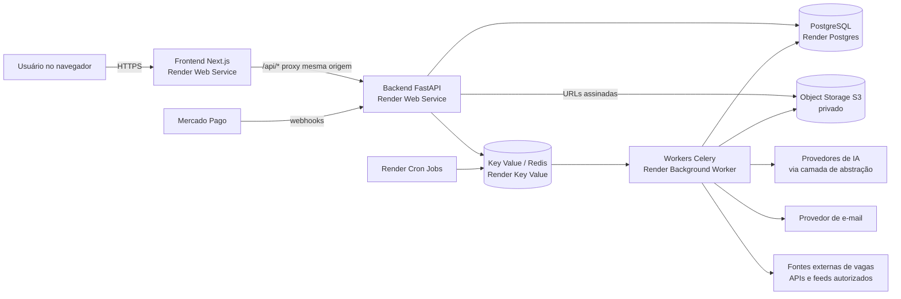
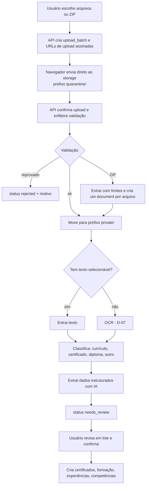

# Arquitetura do sistema

> Como o Vagas IA é construído, implantado e operado.
> Referências: [MASTER_SPECIFICATION.md](MASTER_SPECIFICATION.md) (o quê), [DECISIONS.md](DECISIONS.md) (decisões e alternativas).
> Itens marcados com **[D-xx]** dependem de uma decisão ainda em aberto.

## 1. Princípios

1. **Um produto, dois ambientes:** candidato e empresa no mesmo sistema, com a mesma conta de usuário.
2. **Isolamento por padrão:** todo dado pertence a um usuário ou a uma organização. Nenhuma consulta sem filtro de dono.
3. **Monólito modular:** um backend, um frontend, módulos com fronteiras claras. Microsserviços só se houver necessidade comprovada.
4. **Assíncrono para o que é lento:** leitura de documentos, IA pesada, importação de vagas e e-mails vão para filas.
5. **IA como apoio, nunca como decisor:** toda saída de IA é revisável e tem caminho manual equivalente.
6. **Nada simulado:** nenhuma tela, botão ou integração que pareça funcionar sem funcionar.
7. **Configuração por ambiente:** nenhum segredo no código; tudo por variáveis de ambiente.

## 2. Visão geral



## 3. Componentes

| Componente | Tecnologia | Responsabilidade |
| --- | --- | --- |
| Frontend | Next.js (App Router), React, TypeScript, Tailwind CSS, shadcn/ui **[D-17]** | Interface, roteamento por ambiente, chamadas à API via proxy de mesma origem |
| API | Python 3.12+, FastAPI, Pydantic v2, SQLAlchemy 2 (async), Alembic | Regras de negócio, autenticação, autorização, contratos REST |
| Banco | PostgreSQL 16 com extensões `citext`, `pg_trgm`, `unaccent`, `vector` (pgvector) **[D-09]** | Dados transacionais, busca textual, RLS |
| Fila e cache | Render Key Value (compatível com Redis), política `noeviction` | Broker do Celery, rate limiting, cache curto |
| Workers | Celery **[D-05]** | Documentos, IA, importação de vagas, e-mails, limpeza e retenção |
| Arquivos | Object storage compatível com S3 **[D-06]** | Currículos, certificados, logos, exportações LGPD |
| E-mail | Provedor transacional **[D-12]** | Verificação, recuperação de senha, convites, notificações |
| Pagamentos | Mercado Pago, API de Assinaturas | Planos recorrentes e webhooks |
| IA | Camada própria `ai/providers` | Isola fornecedores; ver AI_SYSTEM_DESIGN.md |
| Observabilidade | Logs estruturados JSON, Sentry **[D-19]**, monitor de disponibilidade | Erros, desempenho, alertas |

### 3.1 Comunicação frontend e backend

**Recomendação [D-10]:** o Next.js encaminha `/api/*` para o FastAPI (rewrite ou route handler), de modo que o navegador fala com uma única origem.

- Cookies de sessão `HttpOnly`, `Secure`, `SameSite=Lax`, sem necessidade de CORS aberto.
- Proteção CSRF por token duplo (cookie `csrf_token` + cabeçalho `X-CSRF-Token`) em métodos que alteram dados.
- O frontend nunca guarda tokens em `localStorage`.
- Páginas públicas (landing, vagas públicas) podem ser renderizadas no servidor para SEO.

### 3.2 Contexto de trabalho

Uma conta pode estar no **modo candidato** ou dentro de uma **organização**. O contexto é explícito na URL:

- Candidato: `/app/candidato/...` no frontend e `/api/v1/me/...` no backend.
- Organização: `/app/empresa/{orgSlug}/...` no frontend e `/api/v1/orgs/{org_id}/...` no backend.
- Administração: `/admin/...` e `/api/v1/admin/...`.

O backend valida em toda requisição que o usuário é membro ativo da organização indicada e possui a permissão exigida. O contexto nunca vem de um cabeçalho escolhido livremente pelo cliente.

## 4. Estrutura do repositório

Monorepo com frontend e backend no mesmo repositório **[D-01]**.

```
vagas-ia-agent/
├── CLAUDE.md                     # regras para o Claude Code
├── README.md
├── docker-compose.yml            # postgres, valkey, minio, mailpit
├── .env.example
├── render.yaml                   # Blueprint com todos os serviços
├── .github/workflows/            # ci.yml, e2e.yml, security.yml
├── docs/                         # esta documentação
├── legacy/                       # painel pessoal atual (até ser desligado) [D-01]
├── frontend/
│   ├── app/
│   │   ├── (public)/             # landing, planos, vagas públicas, termos, privacidade
│   │   ├── (auth)/               # entrar, cadastrar, recuperar senha, verificar e-mail, convite
│   │   ├── app/candidato/        # dashboard, perfil, cofre, currículos, vagas, candidaturas, mensagens
│   │   ├── app/empresa/[orgSlug]/# dashboard, vagas, pipeline, candidatos, equipe, configurações
│   │   └── admin/                # painel administrativo geral
│   ├── components/
│   │   ├── ui/                   # componentes base (botão, input, modal...)
│   │   └── features/             # componentes por domínio
│   ├── lib/                      # cliente da API, autenticação, utilitários
│   ├── hooks/
│   ├── types/                    # tipos gerados do OpenAPI
│   └── tests/e2e/                # Playwright
└── backend/
    ├── pyproject.toml
    ├── alembic.ini
    ├── migrations/
    ├── app/
    │   ├── main.py               # criação da aplicação FastAPI
    │   ├── core/                 # config, banco, segurança, erros, logging, rls, rate limit
    │   ├── auth/                 # cadastro, login, sessões, tokens, senha
    │   ├── users/                # conta, preferências, consentimentos, LGPD
    │   ├── organizations/        # empresas, membros, convites, papéis, verificação
    │   ├── profiles/             # perfil profissional, experiências, formação, competências
    │   ├── documents/            # upload, cofre, processamento, revisão
    │   ├── resumes/              # currículos, versões, exportação, ATS
    │   ├── jobs/                 # vagas próprias, criador IA, busca
    │   │   └── external/         # conectores de fontes externas
    │   ├── applications/         # candidaturas, histórico, acompanhamento externo
    │   ├── recruitment/          # pipeline, avaliações, entrevistas, relatórios
    │   ├── messaging/            # conversas, mensagens, notificações
    │   ├── ai/                   # provedores, agentes, prompts, custos
    │   ├── billing/              # planos, assinaturas, Mercado Pago, limites
    │   ├── admin/                # painel administrativo
    │   ├── audit/                # trilha de auditoria
    │   ├── storage/              # cliente S3, URLs assinadas
    │   └── workers/              # app Celery e tarefas
    └── tests/
        ├── unit/
        ├── integration/
        └── isolation/            # testes de isolamento entre usuários e empresas
```

Cada módulo de domínio segue o mesmo padrão interno:

```
modulo/
├── router.py      # endpoints FastAPI (camada fina)
├── schemas.py     # Pydantic: entrada e saída
├── models.py      # SQLAlchemy
├── service.py     # regras de negócio
├── repository.py  # consultas (sempre filtradas por dono)
├── permissions.py # chaves de permissão usadas pelo módulo
└── tasks.py       # tarefas assíncronas, quando houver
```

Convenção de idioma **[D-18]:** código, nomes de tabelas e endpoints em inglês; textos da interface, mensagens de erro ao usuário e documentação em português do Brasil.

## 5. Backend: camadas e regras internas

1. **Router** valida entrada (Pydantic), resolve usuário e contexto, verifica permissão e chama o service.
2. **Service** aplica regras de negócio, abre transação, chama repositories, registra auditoria e enfileira tarefas.
3. **Repository** executa consultas. Todo método recebe o dono (`user_id` ou `organization_id`) como parâmetro obrigatório.
4. **RLS no PostgreSQL** é a segunda barreira: mesmo se um repository esquecer um filtro, o banco não devolve dados de outro dono (ver DATABASE_DESIGN.md, seção 4).
5. **Erros** seguem o formato `application/problem+json` (ver API_SPECIFICATION.md).
6. **Tarefas** são idempotentes e recebem apenas IDs, nunca objetos grandes ou dados pessoais em texto.

## 6. Processamento assíncrono

| Fila | Tarefas | Concorrência inicial |
| --- | --- | --- |
| `documents` | validar arquivo, extrair texto, OCR, classificar, extrair dados | 2 |
| `ai` | ATS, personalização, resumos para recrutador, criação de vaga, entrevista | 2 |
| `imports` | importar vagas externas, deduplicar, expirar | 1 |
| `notifications` | e-mails, notificações internas | 2 |
| `maintenance` | retenção, exclusão LGPD, exportação LGPD, limpeza de uploads órfãos | 1 |

Regras:

- Toda tarefa tem `max_retries`, backoff exponencial e tempo limite.
- Falhas definitivas gravam o erro no registro de origem (por exemplo, `documents.status = failed` com `error_code`) e geram notificação ao usuário quando ele estiver esperando o resultado.
- O progresso de lotes (ex.: 23 certificados) é exposto por endpoint de consulta (`GET /api/v1/me/upload-batches/{id}`). O frontend consulta a cada 2 segundos enquanto houver itens em processamento. Server-Sent Events podem substituir a consulta depois.
- Tarefas agendadas rodam como **Render Cron Jobs** que apenas enfileiram tarefas no Celery, para manter a lógica em um único lugar.

## 7. Pipeline de documentos



### 7.1 Limites iniciais (configuráveis pelo administrador)

| Item | Limite |
| --- | --- |
| Arquivos por lote | 30 |
| Tamanho por arquivo | 10 MB |
| Tamanho de ZIP | 50 MB compactado, 200 MB descompactado |
| Arquivos dentro de um ZIP | 50, sem ZIP dentro de ZIP |
| Páginas por documento processadas pela IA | 15 (o restante é armazenado, mas não lido) |
| Tipos aceitos | PDF, JPG, PNG, WEBP, DOCX, ZIP |

### 7.2 Validação de arquivos

- Tipo verificado pelos **bytes iniciais** (assinatura do arquivo), nunca só pela extensão ou pelo `Content-Type` enviado.
- Nome original guardado só como metadado; o nome no storage é um UUID.
- ZIP: rejeitar caminhos com `..` ou absolutos, links simbólicos, arquivos criptografados, proporção de compressão acima de 100:1 (proteção contra zip bomb).
- PDF: rejeitar arquivos com JavaScript embutido ou criptografados; limitar páginas.
- DOCX: rejeitar macros (`.docm` não é aceito).
- Hash SHA-256 por arquivo: se o mesmo usuário já enviou o mesmo arquivo, avisar e não processar de novo.
- Antivírus **[D-08]**: recomendado a partir do lançamento público.

### 7.3 Revisão

O resultado da IA nunca vira dado oficial sem confirmação. A tela de revisão mostra cada documento com os campos extraídos, o nível de confiança e o trecho de origem, permitindo editar, aceitar, aceitar todos ou descartar.

## 8. Armazenamento de arquivos

- Bucket privado, sem acesso público.
- Prefixos: `quarantine/` (aguardando validação, expira em 24 h), `private/users/{user_id}/`, `private/orgs/{org_id}/`, `exports/{user_id}/` (expira em 7 dias).
- Downloads por URL assinada com validade de **5 minutos**, gerada só após checagem de permissão; cada geração para documento de terceiro (ex.: recrutador abrindo currículo) é registrada em auditoria.
- Logos de empresas e fotos públicas (se existirem) ficam em bucket ou prefixo público separado, depois de validados.
- Versionamento do bucket ligado em produção, com regra de expiração de versões antigas em 30 dias.

## 9. Busca de vagas e integrações externas

### 9.1 Situação real das fontes desejadas (pesquisa de novembro de 2026)

| Fonte | O que existe | Uso possível no Vagas IA |
| --- | --- | --- |
| Gupy | API voltada a empresas clientes da Gupy (criar e atualizar vagas, ler candidaturas, página de carreiras externa) e feed de vagas para job boards parceiros | Não há API pública de busca para terceiros. Caminho: parceria como job board, ou empresa cliente da Gupy conectando a própria conta |
| LinkedIn | APIs de vagas restritas a parceiros aprovados do Talent Solutions; a Job Posting API não está aceitando novas parcerias e indica o programa Apply Connect | Fora do MVP. Exige parceria formal |
| Indeed | A antiga API pública de busca foi aposentada; APIs atuais (Job Sync, Indeed Apply, Sponsored Jobs) exigem aprovação como parceiro | Fora do MVP. Exige parceria formal |
| InfoJobs, Catho, Vagas.com | Não foi encontrada API pública de busca para terceiros | Fora do MVP. Contato comercial para parceria |
| Jobicy, Remotive | Feeds públicos já usados no painel atual | Podem entrar no MVP, **após conferir os termos de uso** (atribuição, frequência, uso comercial) **[D-14]** |

Conclusão: **não fazer raspagem (scraping) de nenhum site**, nem usar serviços de terceiros que raspam esses portais, porque viola termos de uso e expõe o produto a bloqueios e riscos jurídicos. O MVP terá vagas próprias publicadas pelas empresas no Vagas IA, mais fontes públicas autorizadas. As demais entram conforme parcerias forem firmadas.

### 9.2 Modelo de conectores

Cada fonte é uma classe que implementa a mesma interface:

```python
class JobSourceConnector(Protocol):
    key: str                      # "jobicy", "remotive", ...
    def fetch(self, since: datetime | None) -> Iterable[RawExternalJob]: ...
    def normalize(self, raw: RawExternalJob) -> NormalizedJob: ...
```

Fontes ficam cadastradas em `external_job_sources` com `enabled`, `terms_url`, `terms_reviewed_at` e configuração. Uma fonte sem `terms_reviewed_at` não pode ser habilitada.

### 9.3 Atualização, deduplicação e expiração

- Cron por fonte, na frequência permitida pelos termos (padrão: a cada 6 horas).
- Chave única por fonte: `(source_id, external_id)`; atualização se já existir.
- Deduplicação entre fontes por **impressão digital**: título normalizado + empresa normalizada + cidade + semana de publicação. Duplicadas apontam para a vaga canônica (`duplicate_of_id`) e não aparecem na busca.
- Expiração: vaga que não aparece em 3 importações seguidas ou com mais de 45 dias vira `expired`.
- Cada execução grava um registro em `external_job_import_runs` com contagens e erros, visível no painel administrativo.

### 9.4 Mecanismo de busca

- Uma visão `job_search_view` une vagas próprias publicadas e vagas externas ativas, com colunas comuns.
- Busca textual do PostgreSQL com configuração `portuguese` + `unaccent`, ponderando título (A), competências (B) e descrição (C).
- `pg_trgm` para tolerar erros de digitação no cargo.
- Filtros da especificação: cargo, área, localização, modalidade, salário, tipo de contrato, experiência, escolaridade, data de publicação.
- Ordenação: relevância, data, salário, compatibilidade (quando o usuário tem perfil).
- Busca semântica com `pgvector` como evolução (Fase 6), sem dependência no MVP.
- Candidatura em vaga externa: o Vagas IA abre o link original e oferece registrar o acompanhamento; nunca envia candidatura automaticamente em site de terceiros.

## 10. Ambientes

| Ambiente | Onde | Dados | Implantação |
| --- | --- | --- | --- |
| Desenvolvimento | Computador local, `docker compose` (PostgreSQL + pgvector, Valkey, MinIO, Mailpit) | Sementes fictícias **marcadas como fictícias** | Manual |
| Homologação | Render, instâncias menores, banco separado | Fictícios ou anonimizados, nunca dados reais de produção | Automática a cada merge em `main` |
| Produção | Render | Reais | Manual, por tag de versão (`v0.1.0`) após homologação aprovada |

- Região: todos os serviços na mesma região do Render **[D-16]**. O Render não tem região no Brasil, o que caracteriza transferência internacional de dados (tratado em SECURITY_AND_LGPD.md).
- Banco de produção em plano pago, para ter recuperação a um ponto no tempo (PITR). O plano gratuito do Render não oferece recuperação.
- Grupos de variáveis de ambiente do Render separados por ambiente.

### 10.1 Serviços no Render (Blueprint `render.yaml`)

| Serviço | Tipo |
| --- | --- |
| `vagas-ia-web` | Web Service (Node, Next.js) |
| `vagas-ia-api` | Web Service (Python, FastAPI) |
| `vagas-ia-worker` | Background Worker (Celery) |
| `vagas-ia-cron-imports` | Cron Job (enfileira importação de vagas) |
| `vagas-ia-cron-maintenance` | Cron Job (retenção, limpeza, conferência de assinaturas) |
| `vagas-ia-cron-backup` | Cron Job (pg_dump diário para bucket de backup) |
| `vagas-ia-db` | Render Postgres |
| `vagas-ia-kv` | Render Key Value, `noeviction` |

## 11. CI/CD

| Workflow | Quando | Etapas |
| --- | --- | --- |
| `ci.yml` | todo push e PR | backend: ruff, mypy, pytest com PostgreSQL de serviço, `alembic upgrade head` em banco vazio e checagem de migração pendente; frontend: eslint, `tsc --noEmit`, testes unitários, build |
| `e2e.yml` | PR para `main` | sobe a stack com docker compose e roda Playwright |
| `security.yml` | semanal e em PR | `pip-audit`, `npm audit`, varredura de segredos (gitleaks) |

Fluxo de branches: `main` protegida, trabalho em `feat/...`, `fix/...`, `docs/...`, merge só por PR com CI verde.

## 12. Operação

### 12.1 Monitoramento

- Logs JSON com `request_id`, `user_id` (quando houver), rota, status e latência. Nunca registrar senhas, tokens, conteúdo de documentos ou texto de currículos.
- Sentry no frontend e backend, com remoção de dados pessoais antes do envio.
- Monitor externo de disponibilidade em `/api/health` (vivo) e `/api/health/ready` (banco, fila e storage respondendo).
- Painel administrativo com: tamanho das filas, tarefas falhas nas últimas 24 h, custo de IA por dia, importações com erro, webhooks pendentes.
- Alertas: API fora do ar por 5 min, fila `documents` com mais de 15 min de atraso, custo diário de IA acima do teto, falha de backup.

### 12.2 Backups e recuperação

| Camada | Mecanismo | Retenção |
| --- | --- | --- |
| Banco | PITR do Render Postgres (plano pago) | Janela do plano (3 ou 7 dias, conforme workspace) |
| Banco | `pg_dump` diário criptografado para bucket separado | 30 dias |
| Arquivos | Versionamento do bucket | 30 dias para versões antigas |

- Metas: perda máxima de dados (RPO) de 24 h no pior caso e minutos com PITR; tempo de recuperação (RTO) de 4 h.
- **Teste de restauração mensal** em homologação, com registro do resultado.
- Roteiro de incidentes em `docs/runbooks/` (criado na Fase 8): banco indisponível, vazamento suspeito, fila travada, provedor de IA fora, webhook do Mercado Pago falhando.

### 12.3 Falhas de dependências externas

| Dependência fora | Comportamento |
| --- | --- |
| Provedor de IA | Tarefas ficam em espera com nova tentativa; usuário vê "processamento atrasado"; caminho manual continua disponível |
| Mercado Pago | Checkout indisponível com mensagem clara; webhooks são reprocessados quando voltar; ninguém perde acesso por falha do gateway |
| Provedor de e-mail | Fila guarda e reenvia; tela de verificação permite reenviar |
| Fonte de vagas externa | Importação registra erro; vagas existentes continuam até expirar |
| Storage | Upload bloqueado com mensagem; API continua no ar para o resto |
